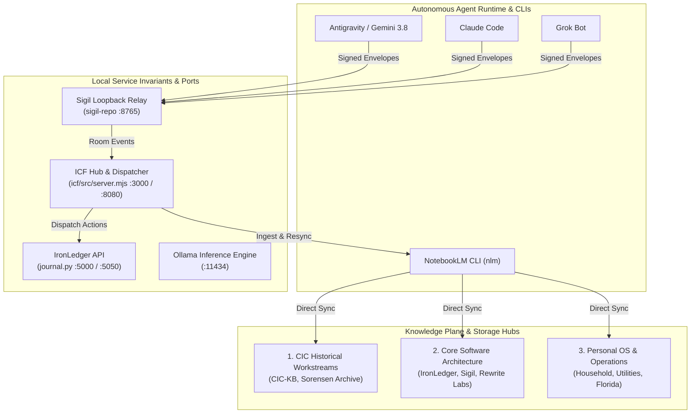
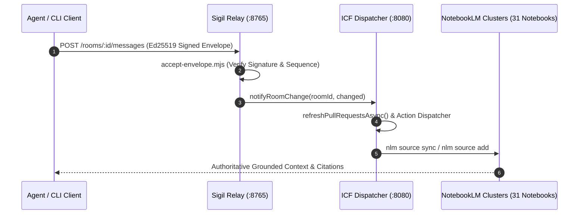

# Ecosystem Architecture Guide (Current)

> **Document Status:** Authoritative Architectural Standard  
> **Last Synchronized:** 2026-10-31T14:43:42.675Z  
> **Drive Master:** [Ecosystem Architecture Guide (Current).md](https://docs.google.com/document/d/1zTiYlA6NIhJRDsr0_9s0I_oQKUnW6l8eJX6xqYGRM_M/edit?usp=drivesdk&ouid=108918430137219217175)  
> **Target Alignment:** CIC Historical, Core Software Architecture, Personal OS & Organization Repositories

---

## 1. Core Repositories & Engine Status (Knowledge Plane Partitioning)

The knowledge plane is strictly partitioned into three independent domains to eliminate cross-domain concept pollution (e.g., preventing software architecture topics from spilling into historical research packs or daily buffer notebooks):

```
+-----------------------------------------------------------------------------------+
|                              PARTITIONED KNOWLEDGE PLANE                           |
+------------------------------------+----------------------------------------------+
| 1. Historical Workstreams (CIC)    | 2. Core Software Architecture & Dev          |
|    - Willow Run & Aviation         |    - IronLedger Architecture                 |
|    - Ford Executive Dynamics       |    - Sigil Protocol & Federation             |
|    - Post-War                      |    - Agent Harness Registry                  |
|    - Willys-Overland               |                                              |
|    - Cuban Seizures                |    - Rewrite Labs SSG Platform               |
|    - Miami Estate & Retirement     |    - Open Dev Triage Buffer                  |
|    - Rouge & Moving Assembly Line  +----------------------------------------------+
|    - CIC-KB (Master Historical)    | 3. Personal OS & Operations                  |
|    - Daily Research Buffer         |    - Household, Utilities, Florida Logistics |
+------------------------------------+----------------------------------------------+
```

---

## 2. Active Repository Commit Topology

| Repository | Branch | Latest Commit | Date |
|---|---|---|---|
| **dev** | `fix/mcp-playwright-package` | `c360748d` docs(report): add daily report for 2026-10-31 | 2026-10-31 06:00:12 -0400 |
| **kb-sync** | `main` | `5539d31b` feat(specs): upgrade TRM Ingest Drive statechart to interactive SVG | 2026-10-30 20:20:37 -0400 |
| **sigil-repo** | `main` | `9a170c4` Merge pull request #151 from sorensencc-dotcom/optimize-after-commit-concurrently-8556602697159938007 | 2026-10-30 10:15:26 -0400 |
| **rewrite-mcp** | `fix/mcp-server-package` | `c6f9184` [gemini] fix(contentdm): clean up partial files on failure and add unit tests | 2026-10-25 11:13:59 -0400 |
| **icf** | `main` | `f6489a5` Merge pull request #48 from sorensencc-dotcom/fix-unused-mkdirsync-15138090319976470186 | 2026-10-30 08:57:18 -0400 |

---

## 3. Active MCP Tooling & Server Topology

| MCP Server | Tool Count | Key Tools |
|---|---|---|
| **browseros-neo** | 25 | act, await_human_help, browser_profiles, browser_target, ... |
| **chrome-devtools-mcp** | 32 | click, close_page, drag, emulate, ... |
| **claude-mem** | 19 | build_corpus, dumb_search, get_observations, get_tool_uses, ... |
| **context7** | 2 | query-docs, resolve-library-id |
| **gemini-api_gemini-api-docs** | 2 | gemini_get_doc, gemini_search_docs |
| **github-mcp-server** | 47 | add_comment_to_pending_review, add_issue_comment, add_reply_to_pull_request_comment, assign_copilot_to_issue, ... |
| **gmp-code-assist** | 2 | retrieve-google-maps-platform-docs, retrieve-instructions |
| **google-cloud-logging** | 6 | get_bucket, get_view, list_buckets, list_log_entries, ... |
| **google-cloud-resource-manager** | 1 | search_projects |
| **google-developer-knowledge** | 3 | answer_query, get_documents, search_documents |
| **graft** | 0 | - |
| **ijfw-memory** | 13 | ijfw_brain, ijfw_cross_audit_converge, ijfw_cross_project_search, ijfw_memory_facts, ... |
| **kb-context-cache** | 3 | fetch_topic_note, query_context_cache, vfs_upsert_document |
| **notion-mcp-server** | 24 | API-create-a-comment, API-create-a-data-source, API-delete-a-block, API-get-block-children, ... |
| **trail** | 8 | finish_skill, get_brand, get_context, list_workspaces, ... |

---

## 4. Local Service Ports & Active System Topology

| Service / Subsystem | Local Port(s) | Topology Role & Endpoint Details |
|---|---|---|
| **ICF (Iron Core Fabric)** | `3000 / 8080` | Local dashboard, orchestrator, and telemetry frontend |
| **IronLedger Workbench** | `5000 / 5050` | Double-entry core accounting API and administration workbench |
| **Sigil Loopback Relay** | `8765` | Cryptographic identity relay and federated protocol broker |
| **Ollama Inference Engine** | `11434` | Local model inference provider and embeddings service |

---

## 5. Target Notebook Cluster Directory

| Category | Notebook ID | Title |
|---|---|---|
| Historical CIC | `679b8bab-2d87-42cb-a726-6dc54c83acc2` | CIC-KB |
| Historical CIC | `1b4861a3-931f-4632-8fc1-343a8dd37df8` | CIC - Daily Research |
| Historical CIC | `ef78168d-b7b9-4952-8e0f-fcb353a21181` | Willow Run Videos |
| Historical CIC | `b8bc161d-495f-42f9-a7d1-ed8692141f6b` | Cast Iron Charlie - Research Logs |
| Historical CIC | `fd0e0e4e-6890-4fb9-89bf-b9e568295e7a` | The Sorensen Photographic Archive: Industrial Giants at Willow Run |
| Historical CIC | `0c8dc979-319f-4e6d-8136-22275932c236` | CastIronCharlie-Facebook |
| Historical CIC | `039e2c13-75b3-4bf2-b58d-9bbce8f73a4d` | CIC-Reddit |
| Historical CIC | `c8360946-dbee-4a2c-b622-7f89b05695b0` | CIC - Cuban Seizures & Retired Assets |
| Historical CIC | `6fd7c40b-df90-444b-9c7a-a64682925856` | CIC - Willow Run & Aviation Engineering |
| Historical CIC | `9c469910-a900-43a4-877c-a43c9f545b5f` | CIC - Post-War |
| Historical CIC | `fd4ebe29-9440-4f4b-97cf-0184ffbe29a0` | CIC - Willys-Overland |
| Historical CIC | `0caf6707-f8f2-4d2a-acd2-020acead55ba` | CIC - Ford Executive Dynamics & Politics |
| Historical CIC | `48322e1d-d601-4f65-89e0-76282343680d` | CIC - Research Deltas & Living Matrix |
| Historical CIC | `64949154-5892-4fa4-9ad0-e48b2bf5cc6c` | CIC - Miami Estate & Florida Retirement |
| Historical CIC | `70be0df3-c58a-4711-b4d3-1e4b8726faf7` | CIC - Rouge, Model T & Moving Assembly Line |
| Core Software Architecture | `76e1932c-054a-4520-9e83-5e882dffc938` | IronLedger Architecture |
| Core Software Architecture | `26eacb85-2c97-443d-9d81-3bd99cc98412` | Sigil Protocol & Federation |
| Core Software Architecture | `359b346c-6af7-4ba3-baef-b985c9e6e1af` | Agent Harnesses & Local Execution (Graft, SAM, Herdr) |
| Core Software Architecture | `140119ae-3496-45c9-bf0c-71c955136afc` | Rewrite Labs SSG/Redesign Platform |
| Core Software Architecture | `cb0498ce-1ea5-4668-9f65-ac368753404e` | Open Dev Issues (CI/CD Triage Buffer) |
| Personal OS | `9724e682-c5ea-4693-8e21-caf8de68611e` | Personal OS (Household, Utilities, Florida Logistics) |
| Operational | `b42534be-a208-437e-828e-dad645631c66` | KB - Governance |
| Operational | `096b5b92-55d0-44b2-b074-3b3fef0a0d12` | KB - Modules |
| Operational | `3ac216cc-3379-4c9f-8393-ab28a248cecc` | KB - Skills |
| Operational | `1ab8f1a2-f066-4246-8489-75f223d5f9d2` | KB - Operations |
| Operational | `30f80cc0-80f7-421a-a79b-c510d98aaf94` | KB - Meta |
| Operational | `0cab9d12-0f0e-4cc0-9009-69ec809fce4a` | KB - Targets |
| Operational | `95867d03-1175-4516-9b38-d95592b1a321` | KB - Superpowers |
| Operational | `52332bef-552c-427a-afb5-8cc48e6f0079` | Grok Bot Automation |
| Operational | `bec5a197-8256-4eba-af78-c4881cc28fdd` | AI News and Tools |
| Operational | `39a71593-eb5b-4605-a4a4-f212ae010da2` | Toolforge Ecosystem |

---

## 6. Cross-Subsystem Architectural & Sequence Flow Diagrams

### A. Subsystem Topology & Port Architecture


### B. Agent Task Routing & Federation Protocol


### C. Knowledge Plane Domain Isolation

```mermaid
flowchart LR
    subgraph P1["Plane 1: Historical Workstreams (CIC)"]
        direction TB
        CIC1["Willow Run & Aviation"]
        CIC2["Ford Executive Dynamics"]
        CIC3["CIC-KB Master"]
    end

    subgraph P2["Plane 2: Core Software Architecture"]
        direction TB
        DEV1["IronLedger Architecture"]
        DEV2["Sigil Protocol & Federation"]
        DEV3["Rewrite Labs SSG Platform"]
        DEV4["Open Dev Triage Buffer"]
    end

    subgraph P3["Plane 3: Personal OS & Operations"]
        direction TB
        POS1["Household & Utilities"]
        POS2["Florida Logistics"]
    end

    P1 -.->|STRICT BARRIER: No Cross-Domain Leakage| P2
    P2 -.->|STRICT BARRIER: No Cross-Domain Leakage| P3
```


---

## 7. High-Gravity Architectural Contract Hubs (Trail AST Skeletons)

### Subsystem: `sigil-repo`
> **File:** `sigil/relay/v1/room-routes.mjs`  
> **Role:** Room message dispatch & SSE stream session lifecycle  
> **Repo Root:** `C:\dev\sigil-repo`

```javascript
- L23-L27  function send  function send(response, requestId, status, body)
- L29-L31  function fail  function fail(response, requestId, status, code, message)
- L33-L35  function readJson  async function readJson(request, readBody)
- L39-L44  function membership  async function membership(repository, roomId, principal)
- L53-L56  function isAgentCaller  async function isAgentCaller(repository, registry, principal)
- L61-L110  function postHumanMessage  async function postHumanMessage({ response, requestId, now, principal, repository, registry, humanSigner, buildAcceptOptions, roomId, keyPrefix, body, prepare })
- L68-L73  function stored  stored = async ()
- L112-L477  function handleRoomRoute  async function handleRoomRoute({ request, response, parsedUrl, principal, repository, registry, requestId, now, readBody, stream = null, inboxDepthLimit, systemIdentity = null, logger = null, ticketStore = null, humanSigner = null, buildAcceptOptions = null })
- L116-L122  function notifyRoomChange  notifyRoomChange = async (roomId, changed)
```

### Subsystem: `sigil-repo`
> **File:** `sigil/relay/v1/accept-envelope.mjs`  
> **Role:** Federation envelope cryptographic verification & resend handling  
> **Repo Root:** `C:\dev\sigil-repo`

```javascript
- L56-L59  function resendRangeLimit  function resendRangeLimit(options)
- L61-L123  function acceptResendRequest  async function acceptResendRequest(envelope, options, client)
- L125-L138  function toResponse  function toResponse(options, error)
- L142-L144  function senderOnlyMap  function senderOnlyMap(envelope, entry)
- L146-L157  function acceptEnvelope  function acceptEnvelope(envelope, options = {})
- L165-L514  function acceptWithRepository  async function acceptWithRepository(envelope, options)
- L521-L565  function forwardEnvelope  async function forwardEnvelope(envelope, route, options, client)
- L569-L578  function enqueueForward  async function enqueueForward(envelope, route, options, client, { senderKey, senderOwnerId })
- L585-L588  function recordFederationAudit  function recordFederationAudit(repository, eventType, outcome, envelope, payload, now)
- L590-L614  function acceptEnvelopeAsync  async function acceptEnvelopeAsync(envelope, options = {})
```

### Subsystem: `icf`
> **File:** `src/server.mjs`  
> **Role:** Port 8080/3000 telemetry hub & action dispatcher  
> **Repo Root:** `C:\dev\icf`

```javascript
- L23-L62  function refreshPullRequestsAsync  function refreshPullRequestsAsync()
- L64-L70  function getPullRequests  function getPullRequests()
- L72-L91  function parseJsonBody  function parseJsonBody(req)
- L105-L105  function trmInboxDir  trmInboxDir = ()
- L108-L116  function refreshTrmLedgerMarkdown  async function refreshTrmLedgerMarkdown()
- L130-L132  function isLoopback  function isLoopback(address)
- L157-L167  function resolveTargetRepo  function resolveTargetRepo(targetOrDomain)
- L169-L171  function importTelemetry  function importTelemetry(file)
- L173-L182  function findToolforgeSkill  function findToolforgeSkill(target, manifestPath = TOOLFORGE_MANIFEST)
- L184-L191  function buildToolforgeSkillRunner  function buildToolforgeSkillRunner(target, manifestPath = TOOLFORGE_MANIFEST, toolforgeRoot = TOOLFORGE_ROOT)
- L193-L195  function formatLocalDay  function formatLocalDay(date)
- L197-L200  function shiftLocalDay  function shiftLocalDay(day, delta)
- L202-L209  function isoWeekKey  function isoWeekKey(date)
- L211-L246  function createReportingHistory  function createReportingHistory(options = {})
- L269-L293  function readToolforgeBody  function readToolforgeBody(req)
- L273-L278  function cleanup  cleanup = ()
- L279-L279  function fail  fail = code
- L280-L284  function data  data = chunk
- L285-L285  function end  end = ()
- L286-L286  function error  error = ()
- L287-L287  function aborted  aborted = ()
- L295-L300  function commitTypeForCard  function commitTypeForCard(card = {})
- L302-L324  function buildCardDetailSections  function buildCardDetailSections(card = {})
- L326-L388  function loadArchivedCard  function loadArchivedCard(cardId, lockRow = null, inboxDir = null)
- L390-L1895  function createGatewayServer  function createGatewayServer(options = {})
- L404-L413  function broadcastSseEvent  function broadcastSseEvent(event, data)
- L419-L422  function recordJobHistory  function recordJobHistory(entry)
- L426-L440  function countCommits  async function countCommits(since, until)
- L504-L504  function disconnected  disconnected = ()
- L505-L505  function incomplete  incomplete = ()
- L508-L517  function send  send = value
- L764-L780  function finalizeJob  finalizeJob = (status, code = null, error = null)
- L1161-L1169  function parseReceiptTime  parseReceiptTime = (d)
- L1170-L1173  function isTerminalStatus  isTerminalStatus = (s)
```

### Subsystem: `kb-sync`
> **File:** `watch-competitors-v2.mjs`  
> **Role:** Competitor watchlist monitor & diff engine  
> **Repo Root:** `C:\dev\kb-sync`

```javascript
- L24-L26  function logInfo  function logInfo(msg)
- L28-L30  function logWarn  function logWarn(msg)
- L32-L34  function logError  function logError(msg)
- L42-L99  function isPrivateOrBlockedIp  function isPrivateOrBlockedIp(ipAddress)
- L106-L145  function validateTargetUrl  function validateTargetUrl(urlString, options = {})
- L154-L242  function secureFetchWithPinnedDns  async function secureFetchWithPinnedDns(targetUrl, options = {})
- L250-L273  function resolveSafeWikiPath  function resolveSafeWikiPath(wikiRoot, relativePath)
- L280-L327  function validateWatchlist  function validateWatchlist(data, options = {})
- L334-L369  function canonicalizeJson  function canonicalizeJson(val)
- L375-L382  function generateSigilKeyPair  function generateSigilKeyPair()
- L391-L405  function signSigilEnvelope  function signSigilEnvelope(unsignedEnvelope, privateKeyPem, keyId)
- L413-L425  function verifySigilEnvelope  function verifySigilEnvelope(signedEnvelope, publicKeyPem)
- L462-L482  function fetchTargetContent  async function fetchTargetContent(target, options = {})
- L490-L496  function performLocalDiff  function performLocalDiff(localPath, newPayload)
- L504-L518  function computeLcsMatrix  function computeLcsMatrix(a, b)
- L526-L609  function performStructuredDiff  function performStructuredDiff(localPath, newPayload)
- L617-L619  function keyRegistryPath  function keyRegistryPath(queuePath)
- L637-L670  function persistKeyToFileRegistry  function persistKeyToFileRegistry(keyEntry, queuePath)
- L694-L830  function dispatchSigilEnvelope  function dispatchSigilEnvelope(db, signedEnvelope, queuePath = './sigil-queue.jsonl', profileId, keyOpts = {})
- L840-L859  function dispatchSigilTask  function dispatchSigilTask(db, task, queuePath, profileId)
- L867-L1145  function monitorCompetitorWatchlist  async function monitorCompetitorWatchlist(watchlistPath, optionsOrDbPath = {}, maybeSchemaPath = null)
```

### Subsystem: `marketplace`
> **File:** `src/api/server.js`  
> **Role:** Registry API endpoints & install telemetry  
> **Repo Root:** `C:\dev`

```javascript
- L22-L165  function createApp  function createApp(db, { resolveUser, limiter, provider } = {})
```

---

## 8. Authoritative Agent & CLI Invariant Rules (Source of Truth)

1. **Deterministic Search Policy**:
   - Before performing workspace-wide text searches (`grep`, `rg`, `findstr`), consult the deterministic codebase indexes: run `trail skeleton <file>` or `trail callers <symbol>`.
   - Raw file greps across entire repositories are blocked by governance policy.
2. **Local Port & Dashboard Surface Allocation**:
   - `3000 / 8080`: ICF Dashboard & Action Server. Strictly modify `icf/dashboard/index.html`. Never copy root legacy `dashboard.html`.
   - `5000 / 5050`: IronLedger core accounting API and administration workbench.
   - `8765`: Sigil loopback cryptographic identity relay.
   - `11434`: Local Ollama inference engine.
3. **Knowledge Plane Partitioning Protocol**:
   - Never cross-pollinate concepts across Historical CIC, Core Software Architecture, and Personal OS.
   - Historical research queries must bind strictly to the 15 Historical CIC notebooks (`CIC-KB`, etc.).
   - Software development tasks must bind strictly to Core Software Architecture notebooks.
4. **NotebookLM CLI Synchronization Commands**:
   - Synchronize master Drive source in place: `nlm source sync "<notebook-id>" --confirm`
   - Upload new architectural guide version: `nlm source add "<notebook-id>" --file "C:\dev\docs\Ecosystem Architecture Guide (Current).md"`
