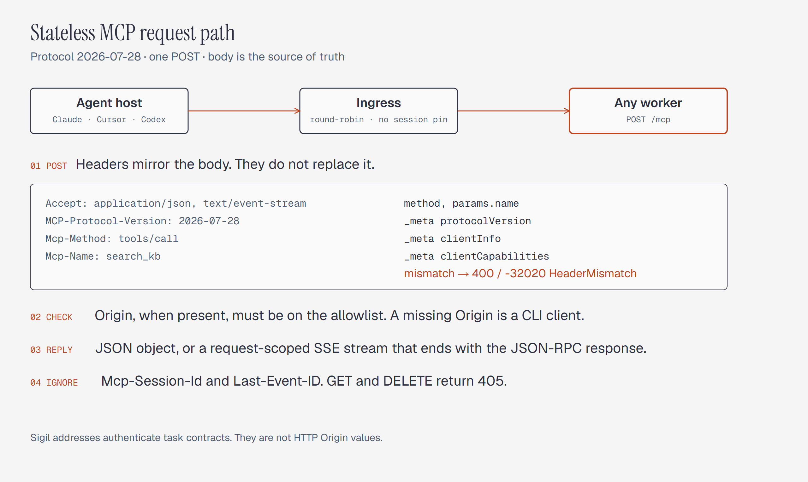
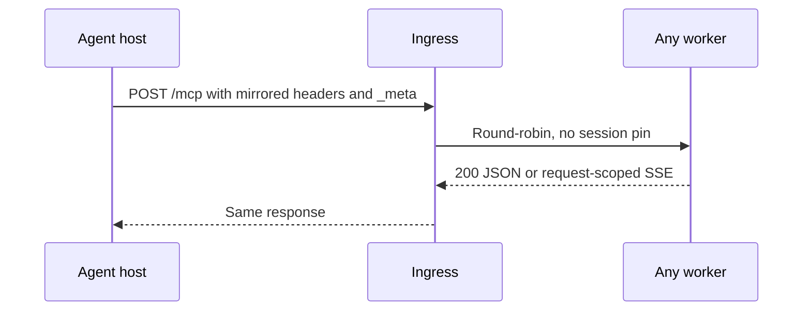
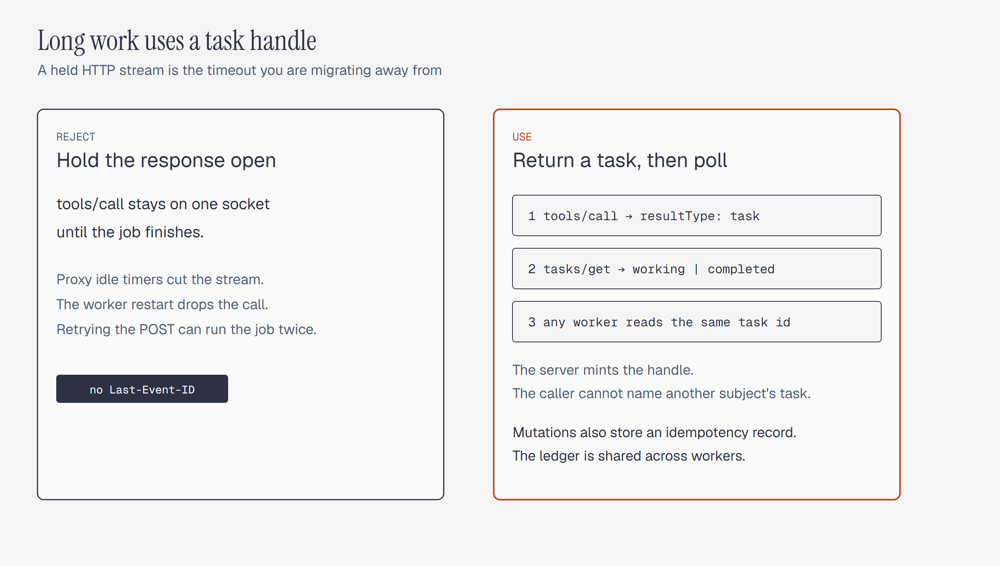
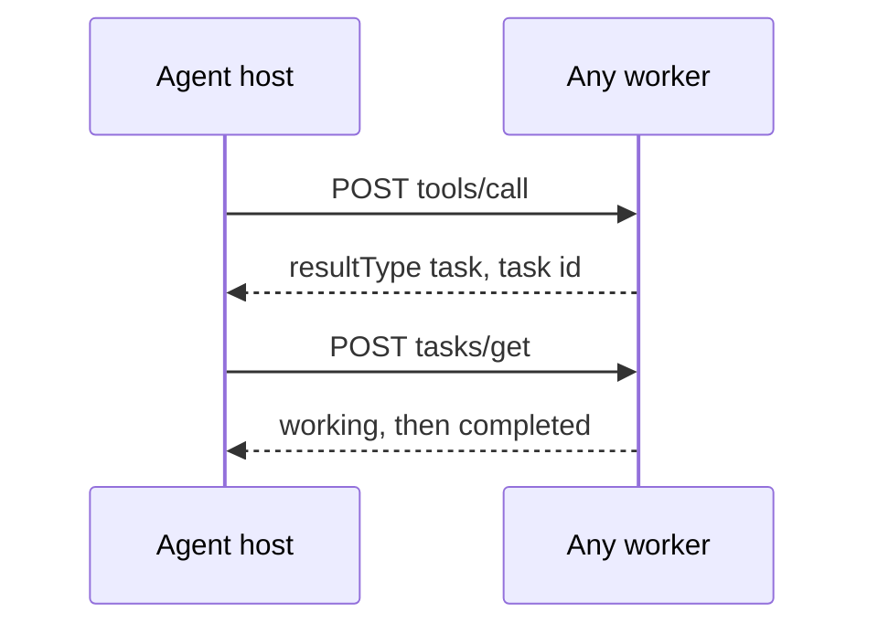

# Stateless MCP architecture and ecosystem migration

| Field | Value |
| --- | --- |
| Status | empty-inventory edge is on the rewrite-mcp HTTP entry, revision 18 |
| Date | 2026-10-10 |
| Normative base | [MCP Streamable HTTP, 2026-07-28](https://modelcontextprotocol.io/specification/2026-07-28/basic/transports/streamable-http) |
| SDK checked | mcp 2.3.0, 2026-10-11. The default interpreter on this machine still has mcp 1.29.0. `@modelcontextprotocol/server` 2.3.1 was executed in-process through `createMcpHandler(...).fetch` on 2026-10-11. That run did not bind a port. The same package's 4 MiB limit was measured the same day on `127.0.0.1:8768` with `toNodeHandler` from `@modelcontextprotocol/node` 2.1.1. npm has no 2.3.1 of that adapter. The listener was stopped after the two requests. |

The SDK is the only server implementation this document allows. History is in the changelog.

## 1. Problem

MCP clients in this ecosystem still speak two older transports.

* **2024-11-05 HTTP+SSE.** The client opens `GET /sse`, reads an `endpoint` event, and POSTs JSON-RPC to a second path, often `/messages`. Every session starts with `initialize` and `notifications/initialized`. [SEP-2596](https://modelcontextprotocol.io/seps/2596-spec-feature-lifecycle-and-deprecation) is the deprecation policy that classifies this transport as Deprecated. It is not the transport specification.
* **Streamable HTTP from 2025-03-26 through 2025-11-25.** One endpoint can serve POST and a standalone GET stream. The server may mint `Mcp-Session-Id`, and the client must send it on later requests. Streams may resume with `Last-Event-ID`. The server may send its own JSON-RPC requests on the SSE stream. Sticky routing and lost offsets come from this generation, not from 2024-11-05.

Revision 2026-07-28 removes protocol sessions, the handshake, the standalone GET stream, server-initiated JSON-RPC requests, and stream resumption. The [2026-07-28 changelog](https://modelcontextprotocol.io/specification/2026-07-28/changelog) records SEP-2575 (version, client identity, and capabilities move onto every request) and SEP-2567 (cross-call state uses a server-minted handle passed back as a tool argument).

Reported failure classes, with no measured rates in this document:

| Failure class | Cause in the old transports | What 2026-07-28 changes |
| --- | --- | --- |
| Dropped SSE socket stalls the caller | A long-lived stream has no request-scoped end, so a vanished socket never fails the call. | Each POST has its own response. Closing that response stream cancels the request ([Cancellation](https://modelcontextprotocol.io/specification/2026-07-28/basic/transports/streamable-http)). |
| Proxy buffers the first SSE bytes | Intermediaries hold headers until a DATA frame. | When you open an SSE response, send `X-Accel-Buffering: no`. On a quiet `subscriptions/listen` stream, emit an SSE comment keep-alive (a line that starts with `:`). Both are in [Streamable HTTP](https://modelcontextprotocol.io/specification/2026-07-28/basic/transports/streamable-http). mcp 2.3.0 emits `: ping\r\n\r\n`. |
| Host cuts a long-held HTTP stream | The work lived inside one open response. | Long work returns a task handle. The client polls `tasks/get`. |
| Worker death drops the call | `Mcp-Session-Id` pinned the client to one process. | Any worker can serve the next POST. Session headers are ignored. |

Treat those rows as the migration motives. Attach counts from production logs before anyone ranks them.

`tools/wiki-browser-qa/neo-adapter.mjs` posts `tools/list` and `tools/call` at `2026-07-28` and does not store a session id. Other hosts still send the handshake. A ban on legacy traffic stays off until that inventory is empty.

## 2. Wire contract

The server exposes one path. This document uses `POST /mcp`. The body is one JSON-RPC request. The body is the source of truth. Headers mirror selected fields so a proxy can route without parsing JSON.

Compare a mirrored header to the body only where this list says to compare it. Header names are case-insensitive. Header values are case-sensitive.

* `MCP-Protocol-Version` must equal `_meta["io.modelcontextprotocol/protocolVersion"]` on a 2026-07-28 request.
* `Mcp-Method` must equal `method`.
* `Mcp-Name` is checked only for `tools/call` (`params.name`), `resources/read` (`params.uri`), and `prompts/get` (`params.name`). On any other method, an extra `Mcp-Name` is not a mismatch.
* A value that is not visible ASCII uses the sentinel `=?base64?<utf-8-base64>?=`. Compare the decoded value to the body.

A required mirror that disagrees is HTTP 400 and `-32020`. mcp 2.3.0 applies that comparison after it picks an era. A `MCP-Protocol-Version` of `2024-11-05`, `2025-03-26`, `2025-06-18`, or `2025-11-25` takes the legacy dispatcher even when `_meta` says `2026-07-28`, and the response is the legacy error. Use a non-handshake header, such as `2026-07-28` against a different `_meta` version, when you want `-32020` from mcp 2.3.0. `createMcpHandler` returns `-32020` for that handshake-header pair as well. It leaves the legacy dispatcher for an `initialize` that carries a handshake header and no modern `_meta`. Section 5 tells gate 1 to record which server each host talks to. While that inventory has rows, one malformed request has two answers.

On mcp 2.3.0 that downgrade is intentional while gate 1 still has rows. The header selects the dispatcher. `_meta` does not. A handshake header is a legacy client, so `server/discover` returns the legacy `-32601` (method not found) inside HTTP 200 SSE. When the inventory is empty, gate 5 stops this path at the edge. A `POST /mcp` whose `MCP-Protocol-Version` is a handshake version returns HTTP 400 and JSON-RPC `-32022`, with `data.supported` and `data.requested`, and the process does not answer `initialize`. A `GET /mcp` returns HTTP 405, `Allow: POST`, and an empty body. Neither rejection applies while gate 1 still has rows.

Origin and the body limit run on the legacy path as well as the modern path. `RequestBodyLimitMiddleware` wraps the session manager before the era split. The legacy transport calls `TransportSecurityMiddleware.validate_request` before it dispatches on method. On 2026-10-11, against the sample with `stateless_http=True`:

* `POST` with `MCP-Protocol-Version: 2025-11-25` and `Origin: https://evil.example` returned HTTP 403 and the text `Invalid Origin header`.
* The same version header with `Content-Length: 4194305` returned HTTP 413 and the text `Request body too large`.
* A missing `Origin` stays allowed. Section 2.3 still requires authentication before a non-loopback bind.

### 2.1 Request

```http
POST /mcp HTTP/1.1
Host: 127.0.0.1:8765
Content-Type: application/json
Accept: application/json, text/event-stream
MCP-Protocol-Version: 2026-07-28
Mcp-Method: tools/call
Mcp-Name: search_kb

{
  "jsonrpc": "2.0",
  "id": 1,
  "method": "tools/call",
  "params": {
    "name": "search_kb",
    "arguments": { "query": "stateless transport" },
    "_meta": {
      "io.modelcontextprotocol/protocolVersion": "2026-07-28",
      "io.modelcontextprotocol/clientInfo": { "name": "codex", "version": "0.0.0" },
      "io.modelcontextprotocol/clientCapabilities": {},
      "dev.toolforge/clientRequestId": "6f1e2c0a-7b34-4d5e-9a10-2c8b7d6e5f40"
    }
  }
}
```

Required on every POST:

* `Accept` lists both `application/json` and `text/event-stream`.
* `MCP-Protocol-Version` equals `_meta["io.modelcontextprotocol/protocolVersion"]`.
* `Mcp-Method` equals `method`.
* `_meta["io.modelcontextprotocol/clientCapabilities"]` is present. Send `_meta["io.modelcontextprotocol/clientInfo"]` as well. mcp 2.3.0 treats `clientInfo` as optional; this document still requires hosts to send it.
* Servers must implement `server/discover`. Clients may call it, or they may send any other method and handle `-32022`.

`Mcp-Name` follows the rule above. It is required on the three named methods and ignored as a mirror on every other method.

`params._meta["dev.toolforge/clientRequestId"]` is the idempotency id from section 3.2. A mutation must send it. A read may omit it. The example includes it so the spelling has one place. The second label is `toolforge`. mcp 2.3.0's 2026-07-28 schema reserves any prefix whose second label is `modelcontextprotocol` or `mcp` (`io.modelcontextprotocol/` and `dev.mcp/` are reserved; `com.example.mcp/` is not, because its second label is `example`). Do not send `io.modelcontextprotocol/clientRequestId`. Do not put the id in `arguments`. The fingerprint in section 3.2 does not cover it.

### 2.2 Responses

A cell that names one runtime is that runtime's answer. Section 8 repeats the wire rows as the checks a gate fails against, split the same way.

| Situation | HTTP | JSON-RPC |
| --- | --- | --- |
| Success | 200 | `result.resultType` of `complete`, `input_required`, or `task` |
| Notification the server accepts | 202 | empty body |
| Missing or disagreeing mirror header | 400 | `-32020` `HeaderMismatch` |
| Client lacks a required capability | 400 | `-32021` |
| Version the server does not implement | 400 | `-32022`, `data.supported`, `data.requested` |
| Malformed JSON | 400 | `-32700` |
| Invalid JSON-RPC | 400 | `-32600` |
| Unknown method | 404 | `-32601` |
| `Accept` omits `application/json` or `text/event-stream` | 406 on mcp 2.3.0, empty body. 200 `application/json` on `createMcpHandler` | Section 8 keeps both answers. This migration adds no `Accept` parser |
| `Origin` present and not allowlisted | 403 | mcp 2.3.0 sends plain text `Invalid Origin header`. On `createMcpHandler` the 403 comes from the middleware in section 2.3. The handler alone returns 200, and that 200 fails gate 3 |
| `GET /mcp` with no version header, or with a handshake version, while gate 1 has rows | mcp 2.3.0: 200 `text/event-stream` when `Accept` contains `text/event-stream`; 406 and `-32600` otherwise. `createMcpHandler`: 405 `application/json` | mcp 2.3.0 with `stateless_http=True` still opens the stream. `MCPServer.run` on `streamable-http` has no argument that closes it. `createMcpHandler` returns `-32000`, message `Method not allowed.`, and no `Allow` header |
| `GET /mcp` with `MCP-Protocol-Version: 2026-07-28`, while gate 1 has rows | mcp 2.3.0: 405, `Allow: POST`, empty body. `createMcpHandler`: 405 `application/json`, `-32000`, no `Allow` header | The mcp 2.3.0 modern handler rejects every non-POST after the Origin check and before JSON-RPC. Observed 2026-10-11 |
| `GET /mcp` after the legacy inventory is empty | 405, `Allow: POST`, empty body, including a missing version header and a handshake version, on both runtimes | The edge returns this. Neither SDK returns this for a missing version header. Gate 5 names the rule |
| `POST /mcp` with a handshake-era `MCP-Protocol-Version` after the inventory is empty | 400 | `-32022`, `data.supported`, `data.requested`, on both runtimes. The edge returns this and does not answer `initialize`. While gate 1 has rows, mcp 2.3.0 still reaches the legacy dispatcher, and `createMcpHandler` returns `-32020` when that POST also carries a modern `_meta` |
| `DELETE /mcp` | 405 | mcp 2.3.0 answers `-32600`, `Session termination not supported`. `createMcpHandler` answers `-32000` |
| Same `dev.toolforge/clientRequestId`, fingerprint differs, or the call is in progress and has not stored a task | 400 on a 2026-07-28 request | `-32602`, `data.reason` below. In progress also sends `data.retryAfterSeconds`. mcp 2.3.0 maps `-32602` to HTTP 400 and leaves `-32603` on HTTP 200. It maps no code to HTTP 409 |
| Body larger than the server limit | 413 | mcp 2.3.0 closes the connection and sends no JSON-RPC body. `createMcpHandler`, measured on a socket, sends JSON-RPC `-32000` and names `4194304`. Default limit 4 MiB (`4194304`) on both |

A 200 body is either `Content-Type: application/json` or `Content-Type: text/event-stream`. On an SSE response the server may send `notifications/progress` or `notifications/message` for that request, then the final JSON-RPC response, then close the stream. The server must not send its own JSON-RPC requests on that stream. Send `X-Accel-Buffering: no` when you open the stream ([Streamable HTTP](https://modelcontextprotocol.io/specification/2026-07-28/basic/transports/streamable-http)).

Closing the SSE response stream cancels that request. The server must stop work for it and must not send further messages for it ([Cancellation](https://modelcontextprotocol.io/specification/2026-07-28/basic/patterns/cancellation)). `notifications/cancelled` is the stdio signal, not the HTTP one.

`subscriptions/listen` is the exception that stays open. It carries only the notification types the client named (`toolsListChanged`, `promptsListChanged`, `resourcesListChanged`, `resourceSubscriptions`). Emit a colon comment (`:\n`) while the stream is idle. There is no `Last-Event-ID` resume. To resume, the client opens a new listen.

Ignore `Mcp-Session-Id` and `Last-Event-ID`. Do not mint a session id.

A modern client that receives HTTP 400 must read the body before it falls back to `initialize`. `-32020`, `-32021`, and `-32022` mean the server speaks this revision. An empty body, or a body that is not one of those errors, is the signal to try the legacy handshake.

### 2.3 What this revision does not put in headers

* Sigil `@` names and `relayDomain` are application identity. They do not belong in the `Origin` check. Authenticate a Sigil task contract inside the toolforge policy check, after the HTTP request is a valid MCP message.
* `Origin` is enforced only when the header is present. Browser clients send it. CLI clients often do not. Bind loopback servers to `127.0.0.1`, not `0.0.0.0`. A missing `Origin` on a non-loopback socket is not proof the caller is local. Require authentication before you bind any other interface.
* On mcp 2.3.0 the SDK transport-security check returns the 403. `createMcpHandler` does not. The package documents that handler as validation-free and shows `originValidationResponse` in front of `handler.fetch` ([`@modelcontextprotocol/server` 2.3.1 type entry](https://unpkg.com/@modelcontextprotocol/server@2.3.1/dist/index.d.mts)). A TypeScript mount calls `originValidationResponse(request, localhostAllowedOrigins())` and, when that call returns a `Response`, returns it without calling `handler.fetch`. `localhostAllowedOrigins()` is `localhost`, `127.0.0.1`, and `[::1]`. A missing `Origin` makes the helper return `undefined`, and the handler runs. This middleware is a precondition of gate 3 step 3. HTTP 200 for `Origin: https://evil.example` fails that step. The empty-inventory edge does not stand in for the middleware: gate 3 moves rewrite-mcp while gate 1 still has rows. Section 9 allows this one call. The middleware does not parse JSON-RPC, `Accept`, or mirrored headers.
* CORS middleware answers browser preflight. It is not the `Origin` 403 rule.

### 2.4 Request path



<details>
<summary>Mermaid source...</summary>



</details>

The editable diagram is [stateless-mcp-request.html](diagrams/stateless-mcp-request.html).

## 3. State, tasks, and idempotency

Protocol state is gone. Application state uses a handle the server mints, or a task id from the `io.modelcontextprotocol/tasks` extension.



<details>
<summary>Mermaid source...</summary>



</details>

The editable diagram is [stateless-mcp-tasks.html](diagrams/stateless-mcp-tasks.html).

### 3.1 Pick the mechanism by the shape of the work

| Work | Mechanism |
| --- | --- |
| One call, one result | `resultType: "complete"` on that POST |
| The tool needs a confirmation or a sampled completion | `resultType: "input_required"` and `inputRequests`. The client sends a new POST of the same method with `inputResponses`. |
| The tool outlives a proxy timeout | `resultType: "task"`. The client polls `tasks/get`. Input in flight uses `tasks/update`. Cancellation uses `tasks/cancel`. |
| Tool list or resource-change notifications | `subscriptions/listen` |
| A ledger mutation that must not run twice | Task or complete result, plus the idempotency record below |

Do not keep `tools/call` open until a multi-minute job finishes. That is the timeout in section 1. Do not invent `execution_id`, `job_token`, or `transaction_handle` as a parallel protocol. If a tool needs a handle, the server creates it and returns it inside the result. The client passes it back as a normal argument. The server checks that the authenticated subject owns the handle.

Authorization is the HTTP `Authorization` header, following the MCP authorization specification (OAuth 2.1 and OpenID Connect). Do not put a bearer token in the JSON body. Bodies land in traces.

### 3.2 Idempotency for mutations

Use this only for mutations. Reads return the current value and do not take a lock.

The record key is `idempotency:v1:{caller_subject}:{client_request_id}`.

`client_request_id` is the string at `params._meta["dev.toolforge/clientRequestId"]`. The client generates one UUID per logical attempt. A retry sends the same id and the same call. Section 2.1 shows the field. It is not a header, and it is not inside `arguments`. A mutation that omits it fails before any insert: JSON-RPC `-32602`, `data.reason` `missing_client_request_id`. On a 2026-07-28 request that is HTTP 400.

The stored fingerprint is the SHA-256 of the [RFC 8785](https://www.rfc-editor.org/rfc/rfc8785) canonical form of this object:

```json
{"method": "<method>", "name": "<params.name or params.uri>", "arguments": "<arguments object, or null>"}
```

`name` is `params.name` for `tools/call` and `prompts/get`, and `params.uri` for `resources/read`. Hashing arguments alone treats two tools with the same arguments as one call. Do not hash `client_request_id`, timestamps, or tokens. Implement canonicalization with a JCS library. Do not re-derive the number format locally.

The SDK transport does not store this ledger. One module per runtime does. The tool function does not.

On Python, pass `ServerMiddleware` as `MCPServer(..., middleware=[...])`. The middleware reads `ctx.method` and the raw `ctx.params`, including `_meta`, before the tool runs, and it owns the compare-and-set. A `@mutation` decorator in that same module registers the tool name. The middleware applies the ledger only to registered names. A read skips it. Import the module. Do not copy the compare-and-set into each tool.

On mcp 2.3.0 those names resolve as follows. `ServerMiddleware` is `mcp.server.context.ServerMiddleware`, an async `(ctx, call_next)`. `ctx.method` and `ctx.params` are fields of `mcp.server.context.ServerRequestContext`. Raise `mcp.shared.exceptions.MCPError` with `mcp_types.INVALID_PARAMS` (`-32602`). `get_access_token` is `mcp.server.auth.middleware.auth_context.get_access_token` and returns `mcp.server.auth.provider.AccessToken | None`. The subject is `AccessToken.subject`. `ERROR_CODE_HTTP_STATUS` is `mcp.shared.inbound.ERROR_CODE_HTTP_STATUS`. Do not import that table. Raising `MCPError` is what consults it. [examples/stateless-mcp-python.py](examples/stateless-mcp-python.py) is this middleware, with stub tools `start_job`, `finish_job`, `hold_note`, and `release_hold`.

On TypeScript, the same module is a wrapper around `createMcpHandler`. `stateless_http` is not that wrapper. The reserved `io.modelcontextprotocol/*` keys are lifted out of `_meta` before a v2 handler runs; `dev.toolforge/clientRequestId` is not reserved, so it remains on `params._meta` ([Supporting protocol revision 2026-07-28](https://github.com/modelcontextprotocol/typescript-sdk/blob/main/docs/migration/support-2026-07-28.md)).

`caller_subject` is not a JSON field. The middleware sets a context variable before `call_next`, and the tool layer reads that variable for the ledger key and for handle ownership:

* When `mcp.server.auth.middleware.auth_context.get_access_token()` returns a token, the subject is `token.subject`, the `sub` claim. An empty `subject` rejects with `-32602` and `data.reason` `missing_caller_subject`.
* When that call returns `None` and the middleware was built with `fixed_principal`, the subject is that principal (`local:kb-sync` or `local:ironledger` from section 4). An authenticated server passes no fixed principal, so a missing token does not fall through to a loopback name.
* When there is neither a token subject nor a fixed principal, reject with `missing_caller_subject`.
* Do not call `authenticated_principal()`. It returns a compact JSON array of client id, issuer, and subject, not the raw `sub`.
* On `@modelcontextprotocol/server` 2.3.1, bearer verification exposes `ctx.http.authInfo`. The published verifier docs name `clientId`, `expiresAt`, and `resource`. They do not name `sub`. Record `sub` from the verifier and read that value. Do not use `clientId` as the subject.

Do not put the subject in the JSON body. Bodies land in traces.

The ledger is one shared store visible to every worker that can receive the retry.

* More than one HTTP worker: Redis or Postgres.
* One loopback daemon: a table in the database that daemon already owns.

Embedded SQLite on each worker is not a shared ledger. Do not list it as an alternative for a round-robin pool.

Transitions, all compare-and-set:

| Current record | Same fingerprint | Action |
| --- | --- | --- |
| Absent | — | Insert `IN_PROGRESS` and run |
| `IN_PROGRESS`, and the stored result has `resultType: "task"` | yes | Return that stored result, including the same task id. Do not start a second run. Leave the row `IN_PROGRESS` until the task reaches a terminal state |
| `IN_PROGRESS`, no result stored, and the row is older than the TTL | yes | CAS to `FAILED`, then re-enter under the retry cap. This is the crashed-row path |
| `IN_PROGRESS`, and no result is stored yet | yes | JSON-RPC `-32602`, `data.reason` `idempotency_in_progress`, `data.retryAfterSeconds`. On a 2026-07-28 request, HTTP 400. Do not start a second run |
| `COMPLETED` | yes | Return the stored result. Do not run again |
| `FAILED`, the error is retryable, and the row has been re-entered fewer than 3 times | yes | CAS from `FAILED` to `IN_PROGRESS`, then run once |
| `FAILED`, and the row has already been re-entered 3 times | yes | Do not run. Store `COMPLETED` with `data.reason` `idempotency_retry_exhausted` |
| Any | no | JSON-RPC `-32602`, `data.reason` `idempotency_fingerprint_mismatch`. On a 2026-07-28 request, HTTP 400. Do not run |

A task-shaped call does not stay a task handle after it finishes. The task row and the stored result are one record. `tasks/get` and an idempotent retry both read that record. While the task is running, the row stays `IN_PROGRESS` and the stored body stays `resultType: "task"` with the same task id. The terminal write changes the status and replaces the stored body in the same commit. A reader sees either the pre-commit pair (`IN_PROGRESS` and the task body) or the post-commit pair (`COMPLETED` and the `resultType: "complete"` payload). A retry that arrives before the commit and still receives `IN_PROGRESS` plus the same task id is that pre-commit pair. It is not a second execution. Do not keep a second copy that can disagree after a crash. The sample holds one dict under one `asyncio.Lock` and updates the original task row from `finish_job` before that lock is released. A multi-worker daemon uses one Redis or Postgres transaction for the same pair.

A retryable terminal failure compare-and-sets to `FAILED`. The caller does not own the retry cap. After the first failure, the server compare-and-sets `FAILED` back to `IN_PROGRESS` at most 3 times. The next same-fingerprint retry does not run. The server stores that outcome as `COMPLETED` with `data.reason` `idempotency_retry_exhausted`, so the retention window applies and the id cannot loop. A non-retryable terminal failure compare-and-sets to `COMPLETED` immediately and stores the error body, so a retry returns that same error. The revision 7 run sent `flaky_note` six times on one id: executions 1 through 4, then `idempotency_retry_exhausted` twice.

[MCP error codes](https://modelcontextprotocol.io/specification/2026-07-28/basic/index) reserve `-32020` through `-32099` and forbid new meanings in `-32000` through `-32019`. Both conflicts use `-32602` (invalid params) and `data.reason`. `-32602` is the code mcp 2.3.0 maps to HTTP 400. The reason string is the meaning. The fingerprint mismatch is a bad reuse of the id: do not retry it. The in-progress reason is not a bad parameter. A wrapper that treats every `-32602` as "do not retry" must read `data.reason` first. Resend the same request, including the same `dev.toolforge/clientRequestId`, only when the reason is `idempotency_in_progress`, and wait `data.retryAfterSeconds` before that resend. Do not resend `idempotency_fingerprint_mismatch`, `idempotency_retry_exhausted`, or any other `-32602`. Do not rely on `Client.call_tool` for this. It resends on its own only after `-32020`.

```python
import time
from mcp.shared.exceptions import MCPError

def send_mutation(post):
    try:
        return post()
    except MCPError as exc:
        data = exc.data if isinstance(exc.data, dict) else {}
        if exc.code == -32602 and data.get("reason") == "idempotency_in_progress":
            time.sleep(data["retryAfterSeconds"])
            return post()
        raise
```

`post` must send the same bytes both times. The 2026-10-11 `Client.call_tool` run in section 8 showed that an `application/json` body preserves `data.reason` on `MCPError`. The ledger run showed the in-progress body: `data.reason` `idempotency_in_progress` and `data.retryAfterSeconds` `5`. The sample uses 5. Production sets its own delay. The sample defines this function. On 2026-10-11 a process imported it. A `-32602` with `data.reason` `idempotency_fingerprint_mismatch` raised on the first call. A live `hold_note` returned `idempotency_in_progress`, the function waited 5.01 seconds, and the second call returned HTTP 200 with `executions` 1.

mcp 2.3.0 will not emit HTTP 409 for this. `ERROR_CODE_HTTP_STATUS` maps `-32602` to HTTP 400 and leaves `-32603` on HTTP 200. The writer does not set `Retry-After`, so the delay lives in `data.retryAfterSeconds`. Raise `MCPError` from the middleware and let that table pick the status. A second HTTP writer beside the SDK would be a second parser, which section 6 forbids.

On 2026-10-11, `Client(..., mode="2026-07-28").call_tool` against a stub showed what a literal HTTP 409 does. An `application/json` body of `-32603` or `-32602`, with `data.reason`, raised `MCPError` with that code and that data, and the client sent one POST. A `text/plain` 409 raised `MCPError` `-32603` with message `Server returned an error response` and `data` `None`. `call_tool` resends on its own only after `-32020` (header mismatch). The idempotent resend is the caller's. Send `Content-Type: application/json` so the reason survives.

A process crash leaves `IN_PROGRESS` with no stored body. Give that row a TTL longer than the worst-case task (start at 15 minutes, measure, then set it). The sample constant is `IN_PROGRESS_TTL_SECONDS`, set to 900. On the next same-fingerprint retry, a body-less row older than that constant is compare-and-set to `FAILED` and re-entered under the retry cap. A row that already stores `resultType: "task"` is returned as that task, including after the TTL. Expiry does not start a second task. A body-less row still inside the TTL stays `idempotency_in_progress`.

mcp 2.3.0 catches an exception raised by the tool and returns HTTP 200 with `isError: true`. The sample stores that result as `COMPLETED`, so `_fail` does not see `boom_note`. `_fail` runs when the in-flight call is cancelled, or when the middleware itself raises. A cancel stores `FAILED` and retryable, and the re-entry counts toward the cap. Closing the client socket is the HTTP cancel ([Cancellation](https://modelcontextprotocol.io/specification/2026-07-28/basic/patterns/cancellation)).

Keep every `COMPLETED` row, including a stored error body and an `idempotency_retry_exhausted` row, for 24 hours. The sample does not delete `COMPLETED` rows.

Cap body size before you hash. A retry storm must not allocate an unbounded string.

## 4. Local loopback

`kb-sync/scripts/mcp-memory-server.mjs` is a stdio server. It opens the kb-sync cache database in the client process. A shared loopback process removes the per-call runtime start. It does not, by itself, remove `SQLITE_BUSY`. Busy errors stop when every writer for that file runs inside one process.

Run two daemons. Do not put both databases in one process.

| Daemon | Bind | Database | Subject | Who calls it |
| --- | --- | --- | --- | --- |
| kb-sync | `127.0.0.1:8765` | kb-sync cache only | `local:kb-sync` | Claude Code, Cursor, Codex, after each host is reconfigured |
| IronLedger MCP | `127.0.0.1:8766` | IronLedger's own SQLite file | `local:ironledger` | Finance tools only |

These sockets do not authenticate. `caller_subject` is the fixed principal in the table, and every request on that socket uses it. Every caller of one loopback daemon therefore shares one idempotency namespace, `local:kb-sync` or `local:ironledger`. That sharing is the design: the socket cannot tell the hosts apart. Two local processes that reuse one UUID collide. A new UUID per logical attempt makes that collision unlikely. A handle minted there is owned by that principal. There is no second subject, so a subject A versus subject B check cannot run on these daemons. That check runs where `Authorization` is required. The subject there is the bearer token's `sub` claim. `tasks/get` reads the same store as the idempotent retry. Reject a handle whose stored owner is not that `sub` with HTTP 400, `-32602`, and `data.reason` `handle_owner_mismatch`. The loopback admin stop request uses the same fixed principal.

Phase 1 does not run the stdio server and the daemon as writers of the same file. To compare them, point the daemon at a copy of the database.

On shutdown, stop accepting connections, finish or cancel in-flight requests, checkpoint the WAL, and close the database.

`mcp.run` serves the app with uvicorn. A console interrupt stops the accept loop. uvicorn does not checkpoint SQLite, and it does not receive a Windows service control stop. `MCPServer` runs a `lifespan` context manager on the way in and the way out. The sample opens no database and registers no lifespan. Its ledger is the in-memory dict in section 3.2. A daemon that opens SQLite uses this shape, and the service wrapper or the loopback admin stop must exit the process so the `finally` block runs:

```python
from contextlib import asynccontextmanager

@asynccontextmanager
async def lifespan(_server):
    # Open the database.
    try:
        yield
    finally:
        # Checkpoint the WAL, then close it.
```

Pass `lifespan=lifespan` to `MCPServer`. A POSIX-only signal handler does not cover a Windows service.

No latency or throughput number appears here. The previous draft's 1.2 ms and 982 req/s figures do not match the p50 values printed beside them, and they name no workload. Before you quote a number, run one harness:

1. One tool body, fixed arguments, no network inside the tool.
2. Concurrency 1 and concurrency 8, reported separately.
3. Cold process start, reported separately from steady state.
4. p50, p99, and completed requests per second over at least 30 seconds.
5. The same tool through stdio and through the daemon.

Publish the harness command next to the table. Until that run exists, the only claim you can make is that a long-lived process does not pay process startup on every call.

## 5. Where to migrate

Confirm the current transport in each tree before you delete a route. Earlier drafts named trees that are not this checkout.

| Surface | What is true in this checkout | Order |
| --- | --- | --- |
| `C:\dev\rewrite-mcp` | TypeScript monorepo (`rewrite-mcp-monorepo`). Root `package.json` depends on `@modelcontextprotocol/sdk` `^1.0.0`. The installed copy is 1.29.0, and its `LATEST_PROTOCOL_VERSION` is `2025-11-25`. Confirm whether it still serves `GET /sse` or a 2025 sessionful Streamable HTTP endpoint before you remove routes. | First HTTP server you can dual-home, after the dependency in the next paragraph |
| Toolforge | There is no `C:\dev\toolforge`. `C:\dev\toolforge-marketplace` and `C:\dev\toolforge-pdf` are different trees. Migrate the process that actually terminates MCP, and keep its existing TorqueQuery policy. Do not add a three-retry cap in this work. | Same wave as rewrite-mcp, after the process is identified |
| `kb-sync/scripts/mcp-memory-server.mjs` | Stdio server over the kb-sync cache. | Second, on port 8765, single writer |
| IronLedger | Schema files `0012_connectors_governance.sql`, `0013_compliance_and_governance.sql`, `0014_multi_tenant_federation.sql`, and `0015_failover_and_dr.sql` are connectors, compliance, federation, and failover. They are not an MCP transport. Migrate the MCP adapter only, on port 8766. | Second, separate process |
| Sigil | Federated addresses authenticate task contracts at the policy boundary. They are not an `Origin` allowlist. | After the HTTP servers speak 2026-07-28 |
| graft | Context graph and MCP adapters. Low traffic. Migrate when a host needs the new wire. | Last |
| `tools/wiki-browser-qa/neo-adapter.mjs` | Posts `2026-07-28` `tools/list` and `tools/call`. No session header. | Moved off the sending set. The peer at `127.0.0.1:9010` was not changed |

rewrite-mcp is TypeScript. `stateless_http` is the Python flag and does not apply there. Installed `@modelcontextprotocol/sdk` 1.29.0 configures a stateless transport with `new StreamableHTTPServerTransport({ sessionIdGenerator: undefined })` and does not implement 2026-07-28. The published v2 package is [`@modelcontextprotocol/server` 2.3.1](https://www.npmjs.com/package/@modelcontextprotocol/server/v/2.3.1). Its type entry [exports `createMcpHandler`](https://unpkg.com/@modelcontextprotocol/server@2.3.1/dist/index.d.mts). The migration guide says `createMcpHandler(factory)` serves 2026-07-28 per request and, by default (`legacy: 'stateless'`), also serves 2025-era HTTP per request ([Supporting protocol revision 2026-07-28](https://github.com/modelcontextprotocol/typescript-sdk/blob/main/docs/migration/support-2026-07-28.md)). The same guide says a hand-constructed `Server` or `McpServer` does not put a 2026-07-28 byte on the wire. Those two sentences are not the same claim. The section 8 run below checked the `createMcpHandler` sentence. It did not construct a bare `Server`. Gate 3 does not move a route until the package change in step 3.1 exists. Until rewrite-mcp depends on `@modelcontextprotocol/server`, it cannot migrate. Section 9 forbids a repository-local parser as the substitute. The Origin middleware in section 2.3 is the one call that section allows in front of `handler.fetch`, and gate 3 step 3 requires it.

While gate 1 has rows, a handshake-era `MCP-Protocol-Version` together with `_meta` `2026-07-28` is legacy dispatch on mcp 2.3.0 and HTTP 400 `-32020` on `createMcpHandler`. A client that reaches both servers receives both answers for that request. Gate 1 records which server each host talks to, so the inventory names the failure that host will see.

mcp 2.3.0 with one `MCPServer` and `stateless_http=True` answered both a legacy `initialize` for `2025-11-25` (HTTP 200) and `server/discover` for `2026-07-28` (HTTP 200, `supportedVersions` contains `2026-07-28`) on 2026-10-11. Prefer that over a server that only speaks the new revision, until the inventory is empty. A modern-only server must still return `-32022` with `data.supported` so a dual-era client does not misread the 400 and fall back forever.

mcp 1.29.0 is a different API. `stateless_http` is a `FastMCP` constructor argument, `run` does not take it, and `from mcp.server import MCPServer` raises `ImportError`. Its latest protocol version is `2025-11-25`. Do not satisfy this document with 1.29.0.

## 6. Reference server

Use the SDK. Do not add a second Streamable HTTP parser beside it. Header mirrors, `Accept`, body limits, session handling, and error codes belong to the SDK transport. A hand-rolled `node:http` server drifts from the spec the first time an error code changes, and it cannot be the conformance target.

The loopback sample is [examples/stateless-mcp-python.py](examples/stateless-mcp-python.py). On mcp 2.3.0 it constructs `MCPServer` and calls `mcp.run(transport="streamable-http", host="127.0.0.1", port=8765, stateless_http=True)`. `stateless_http` is a keyword of that `run` overload and of `streamable_http_app`. Both default to `False`. The same file with the argument `auth` binds `127.0.0.1:8767` and installs `StubVerifier` instead of `fixed_principal`. The argument `edge` binds `127.0.0.1:8765` and places `EmptyInventoryEdge` in front of `streamable_http_app(stateless_http=True)`. Default mode and `auth` mode do not install that class. `edge` mode illustrates the proxy rule from gate 5 inside the sample process. It inspects headers there. Copying the class into a repository server is the parser section 9 forbids. The class reads the method, `Origin`, `Content-Length`, and `MCP-Protocol-Version`. It does not parse the JSON-RPC body, so the `-32022` response uses `id` null. A disallowed `Origin`, or a `Content-Length` over 4 MiB, is forwarded to the SDK, which still owns those checks. The file is the only copy of that illustration. Do not paste it back into this document.

Pass `stateless_http=True`. [GHSA-84m7-p3x7-pcfv](https://github.com/modelcontextprotocol/python-sdk/security/advisories/GHSA-84m7-p3x7-pcfv) covers stateful sessions that were not reclaimed before 2.2.0. mcp 2.3.0 reclaims them (`session_idle_timeout` defaults to 1800 seconds) and still defaults to stateful. This migration passes `stateless_http=True` because 2026-07-28 has no protocol session. To mount the app yourself, pass the object returned by `streamable_http_app(stateless_http=True)` through as the ASGI app so its lifespan stays attached. Copying `.routes` onto a new Starlette app drops that lifespan. Enable the SDK transport-security Origin check. Do not substitute `CORSMiddleware`.

`Mcp-Name` is specified in section 2.1.

[GHSA-fmmv-w9g8-j3gc](https://github.com/modelcontextprotocol/python-sdk/security/advisories/GHSA-fmmv-w9g8-j3gc) covers servers that buffered the whole body before applying a limit. mcp 2.3.0 defaults `max_request_body_size` to `4194304`. Set that limit at the edge as well. On 2026-10-11 a body over that limit returned HTTP 413 and reset the connection, with no JSON-RPC body.

A TypeScript server does not use `stateless_http`. On `@modelcontextprotocol/sdk` 1.29.0 the stateless transport is `new StreamableHTTPServerTransport({ sessionIdGenerator: undefined })`, and that package stops at protocol `2025-11-25`. On `@modelcontextprotocol/server` 2.3.1 the HTTP entry is `createMcpHandler`. Replacing `@modelcontextprotocol/sdk` with that package is a dependency change, not a version bump. Gate 3 splits the change from the route move. rewrite-mcp is the TypeScript tree in section 5. It stays on 1.29.0 until that dependency changes. Do not add a private header parser. The Origin call in section 2.3 is the exception, and it is one allowlist check in front of `handler.fetch`.

## 7. Rollout gates

Each gate finishes before the next one starts. A gate is done when its checks pass, not when the code is merged.

1. **Inventory.** List every client in active-branch source text that still sends `initialize` or `Mcp-Session-Id`. `neo-adapter.mjs` was the first row and no longer sends either. `rewrite-docs/src/cic/graph/adapters/McpClientRunner.ts` writes one stdio `tools/call` at `2026-07-28` and no longer sends a handshake. Upstream checkouts stay outside this inventory: `microsoft/markitdown` at `4cc9fa1`, `teng-lin/notebooklm-py` where the upload widget posts `ui/notifications/initialized` as the claude.ai render gate at commit `8a0eaae6`, and gitignored `NanoNets/context-graph-engine`. Other-branch worktrees stay outside it: `weekly-report-wt`, `prepush-wt`, `kb-sync-r2`, `sigil-pkgfix-wt`, and `rewrite-docs-trm-wt`. SDK `Client.connect` callers stay outside it. The handshake they send is inside `@modelcontextprotocol/sdk` `client/index.js`, and those SDK servers still require it: `skills/research-store` tests, `modules/trm-devops/test/mcp.test.ts`, and `rewrite-mcp/tools/mcp/test-portfolio-mcp.js`. Servers that answer `initialize` are not clients. Upstream checkouts and other-branch worktrees do not count as inventory rows. `docs/meta/specs/examples/section-4-harness.mjs` still sends `initialize` and stays unrun. The rewrite-mcp HTTP entry applies the empty-inventory edge, and its two `initialize` rows expect `-32022`. Owned servers no longer answer `initialize`. SDK servers still do. Record the protocol version each host negotiates, and which server that host talks to. While both servers are up, a handshake header plus a modern `_meta` is legacy dispatch on mcp 2.3.0 and `-32020` on `createMcpHandler`.
2. **Loopback, one writer each.** Start the kb-sync daemon on `127.0.0.1:8765` and the IronLedger daemon on `127.0.0.1:8766`. Point each host at one daemon. Keep stdio off that database. Run the harness in section 4 and attach the output.
3. **First remote servers.** Do these in order. Do not fold them into one "move onto" step.
   1. Change the rewrite-mcp dependency from `@modelcontextprotocol/sdk` to `@modelcontextprotocol/server` (add `@modelcontextprotocol/node` only if the process mounts the handler on Node). This does not switch routes. Tests for this step import `createMcpHandler` from `@modelcontextprotocol/server` and do not import a server entry from `@modelcontextprotocol/sdk`. The CI job that enforces the import is `rewrite-mcp-mcp-package`. That job is not in `.github/workflows/` yet. Adding it is this step, so the step is not done while the job is absent. The job fails while `C:\dev\rewrite-mcp\package.json` depends on `@modelcontextprotocol/sdk`, or while a source file imports a server entry from that package. It passes only when a source file imports `createMcpHandler` from `@modelcontextprotocol/server`. Do not add the job before the dependency change. Current CI would fail.
   2. Run the shared table and the `createMcpHandler` table in section 8 against the mounted handler and attach the output. A miss on either of those tables fails the step. The mcp 2.3.0-only table is the other runtime. The 2026-10-11 in-process `handler.fetch` run covers the header rows. It confirms that the default handler serves `2026-07-28` per request and still answers a handshake `initialize` that carries no modern `_meta`. That run did not open a socket. The body-over-4-MiB row is the same day's TCP run on `127.0.0.1:8768` through `toNodeHandler` from `@modelcontextprotocol/node` 2.1.1. An in-process 413 does not satisfy that row. Both attachments are below. The rewrite-mcp process still has to pass the same two tables after step 1.
   3. Move the HTTP entry onto `createMcpHandler` only after the Origin middleware in section 2.3 is on the request path. The middleware calls `originValidationResponse(request, localhostAllowedOrigins())` and returns that `Response` before `handler.fetch`. HTTP 200 for `Origin: https://evil.example` fails this step. Keep legacy `initialize` until gate 1 is empty.

   Move the identified toolforge MCP process through the same three steps when that process is TypeScript, and onto mcp 2.x with `stateless_http=True` when it is Python. Mutations go through the shared ledger in section 3.2. Long jobs return tasks. There is no third runtime in this migration.
4. **kb-sync and IronLedger adapters.** Switch `mcp-memory-server.mjs` and the IronLedger MCP entrypoint to the daemons from gate 2. Verify one writer per database file under two concurrent hosts. On the loopback daemons, verify the ledger subject is the fixed principal from section 4. On an authenticated server, verify a handle from worker A is accepted by worker B for the same `sub` and rejected for a different `sub`.

   The IronLedger HTTP entrypoint is `python -m ironledger.cli mcp --bind`. That command starts `src/ironledger/mcp/loopback.py` on mcp 2.3.0 with `stateless_http=True`. It opens `ironledger.daemon-copy.db` under `IRONLEDGER_MCP_COPY_ROOT` and refuses the repo-root `ironledger.db` and `/var/lib/ironledger/ironledger.db`. `serve_http` stays the parser the direct HTTP tests call. Host configs still launch stdio. On 2026-10-12 a temp copy at `127.0.0.1:8766` answered two `mark_request` calls with one `dev.toolforge/clientRequestId` (`6f1e2c0a-7b34-4d5e-9a10-2c8b7d6e5f41`, label `alpha`). Both were HTTP 200, `resultType` `complete`, `structuredContent.executions` 1, and `structuredContent.owner` `local:ironledger`. `Origin: https://evil.example` was HTTP 403 `Invalid Origin header`. `projection_status` with no client request id was HTTP 200 and `status` `missing`. The repo-root `ironledger.db` stayed 27508736 bytes, mtime_ns `1791403217590981100`. Stdin close checkpointed the copy, the process exited 0, and port 8766 refused connections. The in-memory ledger has no task handle and no in-progress TTL. The section 4 harness is unrun.

   The kb-sync daemon at `kb-sync/scripts/mcp-memory-daemon.mjs` wraps `handler.fetch` with `kb-sync/scripts/mcp-idempotency.mjs`. `mark_request` is the only mutation. `query_context_cache`, `fetch_topic_note`, and `vfs_upsert_document` stay outside the ledger. On 2026-10-12 the process listened on `127.0.0.1:8765` with `KB_CACHE_DB` set to a temp file, so it did not vacuum the live cache. Two `mark_request` calls used id `6f1e2c0a-7b34-4d5e-9a10-2c8b7d6e5f42` and label `alpha`. Both were HTTP 200, `executions` 1, and `structuredContent.owner` `local:kb-sync`. `Origin: https://evil.example` was HTTP 403, JSON-RPC `-32000`, message `Invalid Origin: evil.example`. `query_context_cache` with no client request id was HTTP 200 and returned `[]`. `C:\dev\kb-sync\.kb_cache\knowledge.db` stayed 60305408 bytes, mtimeMs `1791771646296.527`. Stdin close exited 0 and port 8765 refused connections. Host configs still launch stdio.
5. **Enforcement.** Add CI that fails a new `GET /sse` or `POST /messages` route. Leave existing legacy handlers in place while gate 1 still has rows, and leave handshake-era `POST`s, including `initialize`, reaching the process. When the inventory is empty, delete session middleware and stop answering `initialize`. The edge in front of the process then applies two different rejections. `GET /mcp`, with any version header or with none, returns HTTP 405, `Allow: POST`, and an empty body. `POST /mcp` with a handshake-era `MCP-Protocol-Version` (`2024-11-05`, `2025-03-26`, `2025-06-18`, or `2025-11-25`) returns HTTP 400 and JSON-RPC `-32022`, with `data.supported` and `data.requested`. That POST does not enter the legacy dispatcher. mcp 2.3.0 has no `run` argument that does either rejection: a GET with no version header, or with a handshake version, still opens the 2025 stream when `stateless_http=True`, and a handshake-era POST is still the legacy dispatcher. A GET that already carries `MCP-Protocol-Version: 2026-07-28` is 405 from the SDK (empty body, `Allow: POST`). That one request is not this gate. The section 8 edge rows do not pass against the raw SDK process. The sample `edge` mode illustrates those two rejections inside one process. It is not the production proxy.

## 8. Conformance checks

Run these against the SDK server. This document does not ship a parser that already passes them. Wire checks hit the transport. Task, ledger, and auth checks hit the application behind it.

A gate 3 run fails against the shared table and the `createMcpHandler` table. It does not fail against the mcp 2.3.0-only table. The body-limit row in the `createMcpHandler` table is the socket measurement in the subsection below. The in-process `handler.fetch` run does not satisfy that row. After the inventory is empty, both runtimes fail against the edge table. The sample `edge` mode illustrates that table. It is not the proxy the gate deploys.

Write the ledger rows as `POST /mcp` `tools/call` on a tool the `@mutation` decorator registered. Set `MCP-Protocol-Version` and `_meta["io.modelcontextprotocol/protocolVersion"]` to `2026-07-28`. Set `Mcp-Method` to `tools/call` and `Mcp-Name` to `params.name`. Put one UUID in `params._meta["dev.toolforge/clientRequestId"]`. On an authenticated server, send `Authorization: Bearer` and take `caller_subject` from `sub`. On loopback, omit `Authorization` and expect `local:kb-sync` or `local:ironledger`. The sample registers `start_job`, `finish_job`, and `hold_note` as mutations. `python examples/stateless-mcp-python.py` is the loopback process. `python examples/stateless-mcp-python.py auth` is the stub-verifier process.

### Shared, both runtimes

| Check | Expected |
| --- | --- |
| `POST /mcp` `server/discover` with matching headers and `_meta` | 200, `resultType` `complete`, `supportedVersions` contains `2026-07-28` |
| `POST /mcp` `tools/call` with matching `Mcp-Name` | 200, `resultType` present |
| `Mcp-Method` disagrees with `method` | 400, `-32020` |
| `MCP-Protocol-Version: 2026-07-28` and `_meta` version `2025-11-25` | 400, `-32020` |
| Version header is `1900-01-01` and matches `_meta` | 400, `-32022`, `data.supported`, `data.requested` |
| `Mcp-Name` missing on `tools/call` | 400, `-32020` |
| `Mcp-Name` present on `server/discover`, other mirrors matching | 200. Section 2.1 says the extra header is not a mismatch |
| Unknown method, headers otherwise valid | 404, `-32601` |
| No `Origin` header | Not rejected for Origin |
| `Mcp-Session-Id` on an otherwise valid request | Ignored, request still succeeds |

### mcp 2.3.0 while gate 1 has rows

| Check | Expected |
| --- | --- |
| `Accept` missing either media type | 406, empty body |
| `Origin: https://evil.example` | 403, plain text `Invalid Origin header` |
| `MCP-Protocol-Version` is a handshake version (`2025-11-25` or earlier) while `_meta` says `2026-07-28` | Legacy dispatch. The header selects the dispatcher. Intended while gate 1 has rows |
| `GET /mcp` with `Accept: text/event-stream` and no version header, dual-era still on | 200 `text/event-stream` |
| `GET /mcp` with `Accept: text/event-stream` and `MCP-Protocol-Version: 2026-07-28` | 405, `Allow: POST`, empty body |
| `DELETE /mcp` | 405, `-32600`, `Session termination not supported` |
| Body over 4 MiB | 413, connection closed, no JSON-RPC body |
| Handshake-era `POST` with `Origin: https://evil.example` | 403. The legacy path runs the Origin check |
| Handshake-era `POST` with `Content-Length` over 4 MiB | 413. The body limit runs before the era split |

### `createMcpHandler` while gate 1 has rows

The Origin rows are the middleware from section 2.3 plus `handler.fetch`. A handler-only 200 fails gate 3. `Accept` stays the handler's own answer. This migration adds no `Accept` parser.

| Check | Expected |
| --- | --- |
| `Accept` only `application/json`, only `text/event-stream`, `text/plain`, or absent | 200 `application/json` |
| `Origin: https://evil.example`, middleware then `handler.fetch` | 403 from `originValidationResponse`. JSON-RPC `-32000`, message `Invalid Origin: evil.example` |
| No `Origin`, same middleware | The helper returns `undefined`. The handler's response stands |
| Handshake-era header and `_meta` `2026-07-28` | 400, `-32020`. The handler reports the disagreement |
| `initialize`, handshake header, no modern `_meta` | 200 `text/event-stream`, `protocolVersion` of that handshake version |
| `GET /mcp` with no version header, and `GET /mcp` with `MCP-Protocol-Version: 2026-07-28` | Both 405 `application/json`, `-32000`, message `Method not allowed.` No `Allow` header |
| `DELETE /mcp` | 405 `application/json`, `-32000` |
| Body over 4 MiB, on a socket | 413 `application/json`, `-32000`, message names `4194304` bytes. `handler.fetch` in-process does not satisfy this row |
| Legacy `initialize` with `Origin: https://evil.example`, middleware in front | 403 from `originValidationResponse` |

### After the inventory is empty, both runtimes

The edge in gate 5 returns these. Neither raw SDK does. The sample `edge` mode is an illustration of the rule inside one process.

| Check | Expected |
| --- | --- |
| `GET /mcp`, any version header or none | 405, `Allow: POST`, empty body |
| `POST /mcp` with a handshake-era `MCP-Protocol-Version` | HTTP 400, `-32022`, `data.supported`, `data.requested`. The process does not answer `initialize` |

### Application ledger

These rows run against the sample ledger. They are not part of the gate 3 wire check.

| Check | Expected |
| --- | --- |
| Two identical mutation retries while the stored result is `resultType: "task"` | One execution. Same `dev.toolforge/clientRequestId`, same `params.name`, same `arguments`, same `caller_subject`. The retry returns HTTP 200 and the same task id |
| Same id and fingerprint after that task completed successfully | The row is `COMPLETED`. The retry returns the terminal `resultType: "complete"` payload, not the task id |
| Same `dev.toolforge/clientRequestId`, different `arguments` or tool name, same subject | HTTP 400, `-32602`, `data.reason` `idempotency_fingerprint_mismatch`, no second execution |
| `IN_PROGRESS`, no result stored yet, same fingerprint | HTTP 400, `-32602`, `data.reason` `idempotency_in_progress`, `data.retryAfterSeconds`, no second execution |
| `finish_job` for subject A's task, sent by subject B on an authenticated server | HTTP 400, `-32602`, `data.reason` `handle_owner_mismatch`. The task stays `IN_PROGRESS` for subject A |
| `finish_job` with an unknown `taskId`, sent twice with one id | Both HTTP 400, `unknown_task`. The second is not `idempotency_in_progress`, so a rejected call strands no row |
| A mutation that returns a retryable error, retried 5 times with one id | The tool executes 4 times (first call plus 3 re-entries). The next retry is HTTP 400, `data.reason` `idempotency_retry_exhausted` |
| Body-less `IN_PROGRESS` older than `IN_PROGRESS_TTL_SECONDS` | The next same fingerprint runs once and counts as one retry-cap re-entry. A body-less row still inside the TTL returns `idempotency_in_progress` and does not run. A stored `resultType: "task"` older than the TTL is returned as that task |
| Client closes the socket of an in-flight mutation that has stored no body | The row becomes `FAILED` and retryable. The next same fingerprint runs once and counts toward the cap |
| Task id issued to subject A, fetched by subject B on an authenticated server | HTTP 400, `-32602`, `data.reason` `handle_owner_mismatch`. Subject A receives the stored task body. Subject A and subject B are two bearer `sub` values. Loopback uses one fixed principal, so this row does not run there |
| `require_loopback_or_auth("0.0.0.0", authenticated=False)` | Raises `ValueError` |

### Run on 2026-10-11 (revision 6 sample)

Interpreter: mcp 2.3.0. Process: [examples/stateless-mcp-python.py](examples/stateless-mcp-python.py) on `127.0.0.1:8765` with `stateless_http=True`.

| Check | Observed |
| --- | --- |
| `server/discover` | 200, `resultType` `complete`, `supportedVersions` `["2026-07-28"]` |
| `tools/call` `search_kb` | 200, `resultType` `complete` |
| `Mcp-Method` disagrees | 400, `-32020` |
| Header `2026-07-28`, `_meta` `2025-11-25` | 400, `-32020` |
| Header `2025-11-25`, `_meta` `2026-07-28` | 200 SSE, `-32601` for `server/discover`. Intended dual-era dispatch: the header selects the legacy dispatcher |
| Both sides `1900-01-01` | 400, `-32022`, `data.supported` `["2026-07-28"]`, `data.requested` `1900-01-01` |
| `Mcp-Name` missing on `tools/call` | 400, `-32020` |
| Extra `Mcp-Name` on `server/discover` | 200 |
| Unknown method | 404, `-32601` |
| `Accept` is one media type, or missing | 406, empty body |
| `Origin: https://evil.example` | 403, `Invalid Origin header` |
| No `Origin` | 200 |
| `GET` with `Accept: text/event-stream` and no version header | 200 `text/event-stream` |
| `GET` with `Accept: text/event-stream` and `MCP-Protocol-Version: 2026-07-28` | 405, `Allow: POST`, empty body |
| `GET` without that media type | 406, `-32600` |
| Legacy `POST`, `MCP-Protocol-Version: 2025-11-25`, `Origin: https://evil.example` | 403, `Invalid Origin header` |
| Legacy `POST`, `MCP-Protocol-Version: 2025-11-25`, `Content-Length: 4194305` | 413, `Request body too large` |
| `DELETE` | 405, `-32600` |
| `Mcp-Session-Id` | 200 |
| Body larger than 4 MiB | 413, connection reset, no JSON-RPC body |
| Legacy `initialize` for `2025-11-25` | 200 |
| `require_loopback_or_auth("0.0.0.0", authenticated=False)` | `ValueError` |
| Ledger rows | Recorded in the ledger run below. `search_kb` on that same process stayed HTTP 200, `resultType` `complete`, with no `dev.toolforge/clientRequestId` |
| `GET /mcp` after the inventory is empty, with no version header | Not run against an edge. The SDK process still returns 200 for that GET |
| `POST /mcp` with a handshake-era version after the inventory is empty | Not run against an edge. The SDK process still dispatches that POST to the legacy handler |

### Ledger run on 2026-10-11

Interpreter: mcp 2.3.0 at `C:\Users\soren\AppData\Local\Temp\mcp2-verify`. Loopback: `python examples/stateless-mcp-python.py` on `127.0.0.1:8765`, no `Authorization`, subject `local:kb-sync`. Authenticated: `python examples/stateless-mcp-python.py auth` on `127.0.0.1:8767`, `StubVerifier`, bearers `subject-a` and `subject-b`. Both processes exited after the run, and both ports refused connections.

| Check | Observed |
| --- | --- |
| Two `start_job` calls, label `alpha`, one `dev.toolforge/clientRequestId` | Both HTTP 200, `resultType` `task`, same `taskId` `f52a9590-965a-459f-84ab-427a486a6edb`, `executions` 1, `subject` `local:kb-sync` |
| `finish_job` for that `taskId`, then the same `start_job` again | Retry HTTP 200, `resultType` `complete`, `status` `done`, same `taskId`, `executions` 1. The body is not the task result |
| Same id, `label` `beta` | HTTP 400, `-32602`, `data.reason` `idempotency_fingerprint_mismatch`. The following original retry was still the `complete` body, `executions` 1 |
| Second `hold_note` while the first had stored no result | HTTP 400, `-32602`, `data.reason` `idempotency_in_progress`, `data.retryAfterSeconds` 5. After `release_hold`, the blocked call returned HTTP 200, `executions` 1. A later retry of the same id returned that stored body, `executions` 1 |
| `start_job` as bearer `subject-a`, then `tasks/get` | Subject A: HTTP 200, `resultType` `task`, `taskId` `bef2842b-0011-4ad8-900f-e81c801f050d`, `subject` `subject-a`, `executions` 1. Subject B: HTTP 400, `-32602`, `data.reason` `handle_owner_mismatch` |
| `Client.call_tool` against HTTP 409 `application/json` `-32603` and `-32602` | `MCPError` with that code and `data.reason`, one POST |
| `Client.call_tool` against HTTP 409 `text/plain` | `MCPError` `-32603`, message `Server returned an error response`, `data` `None`, one POST |
| Section 8 wire table against `@modelcontextprotocol/server` 2.3.1 `createMcpHandler` | Not run |

### Run on 2026-10-11 (revision 7 sample)

Interpreter: mcp 2.3.0 in a fresh virtual environment. Same two processes as above. The earlier rows were rerun first (start twice, finish then retry, fingerprint mismatch) and matched.

| Check | Observed |
| --- | --- |
| `finish_job` as `subject-b` on `subject-a`'s task | HTTP 400, `-32602`, `handle_owner_mismatch`. Revision 6 accepted this call. `tasks/get` as `subject-b` also 400. `tasks/get` as `subject-a` still returned `resultType` `task`, and `subject-a` then finished it |
| `finish_job` with `taskId` `nope`, same id twice | HTTP 400 `unknown_task` both times |
| `flaky_note` (retryable error) retried 6 times, one id | Executions 1, 2, 3, 4, then HTTP 400 `idempotency_retry_exhausted` twice |
| `boom_note` (tool raises) retried twice, one id | The SDK catches the exception inside the tool call and returns HTTP 200 `isError` true. The ledger stored that result as `COMPLETED`, and the retry returned it. The middleware `_fail` path did not run |

The TTL comparison and the cancelled-call path are in the next run. `send_mutation` is in the revision 9 run.

### TTL and cancel run on 2026-10-11

Interpreter: mcp 2.3.0 at `C:\Users\soren\AppData\Local\Temp\mcp2-verify`. One in-process server from [examples/stateless-mcp-python.py](examples/stateless-mcp-python.py) on `127.0.0.1:8765`, `stateless_http=True`, subject `local:kb-sync`. `IN_PROGRESS_TTL_SECONDS` stayed `900.0`. The TTL rows were seeded in that process's ledger. `started_at` was set with `time.monotonic()`. The run did not wait 900 seconds. The cancel row was a real `hold_note` POST. The client closed that socket after a second POST had returned `idempotency_in_progress`. The process then exited, and port 8765 refused connections.

| Check | Observed |
| --- | --- |
| Body-less `IN_PROGRESS`, `started_at` equal to `time.monotonic()`, `flaky_note` | HTTP 400, `-32602`, `idempotency_in_progress`, `retryAfterSeconds` 5. The row stayed `IN_PROGRESS` |
| Body-less `IN_PROGRESS`, `started_at` 901 seconds behind `time.monotonic()`, `flaky_note` | HTTP 200, `isError` true, `retryable` true, `executions` 1. The row was `FAILED` with `retries` 1 |
| `IN_PROGRESS` storing `resultType: "task"`, `started_at` 901 seconds behind `time.monotonic()` | HTTP 200, the seeded task body, `taskId` `seed-task`, `executions` 1. The row stayed `IN_PROGRESS` |
| Close the socket of in-flight `hold_note`, then repeat that id | The repeat blocked, and a follower received `idempotency_in_progress`. After `release_hold`, the repeat returned HTTP 200, `executions` 1. The row was `COMPLETED` with `retries` 1 |

The ledger rows ran against the sample, including the stub-verifier subject check. The revision 9 run covers the empty-inventory edge, `send_mutation`, and `createMcpHandler`. `rewrite-mcp-mcp-package` is still absent, so gate 3.1 is not done. No route has moved.

### Empty-inventory edge, `send_mutation`, and `createMcpHandler` on 2026-10-11

Python interpreter: mcp 2.3.0 at `C:\Users\soren\AppData\Local\Temp\mcp2-verify`. Edge process: `python examples/stateless-mcp-python.py edge` on `127.0.0.1:8765`. Loopback process for `send_mutation`: the same file with no argument, on the same port, after the edge process had exited. Both ports refused connections afterward.

| Check | Observed |
| --- | --- |
| `send_mutation` and a `-32602` fingerprint mismatch | The callable ran once and the `MCPError` propagated |
| `send_mutation` while `hold_note` was in flight | Two calls. The wait was 5.01 seconds. The second call was HTTP 200, `executions` 1, subject `local:kb-sync` |
| `GET /mcp`, `Accept: text/event-stream`, no version header, edge mode | 405, `Allow: POST`, body length 0 |
| `GET /mcp`, same Accept, `MCP-Protocol-Version: 2026-07-28`, edge mode | 405, `Allow: POST`, body length 0 |
| `POST /mcp` `initialize`, `MCP-Protocol-Version: 2025-11-25`, edge mode | 400, `-32022`, `data.supported` `["2026-07-28"]`, `data.requested` `2025-11-25`, `id` null |
| `server/discover` through that same edge | 200, `resultType` `complete`, `supportedVersions` `["2026-07-28"]` |
| Handshake `POST` with `Origin: https://evil.example`, edge mode | 403, `Invalid Origin header`. The edge forwarded the request |

TypeScript interpreter: Node, `@modelcontextprotocol/server` 2.3.1. The server was `createMcpHandler` from that package, called through `handler.fetch`. No socket was opened. One tool, `search_kb`, was registered with a Zod input shape. `legacy` was left at its default.

| Check | Observed |
| --- | --- |
| `server/discover` | 200 `application/json`, `resultType` `complete`, `supportedVersions` `["2026-07-28"]` |
| `tools/call` `search_kb` with matching `Mcp-Name` | 200, `resultType` `complete` |
| `Mcp-Method` disagrees | 400, `-32020` |
| Header `2026-07-28`, `_meta` `2025-11-25` | 400, `-32020` |
| Header `2025-11-25`, `_meta` `2026-07-28` | 400, `-32020`. The handler reports the disagreement. It does not select the legacy dispatcher |
| `initialize`, header `2025-11-25`, no modern `_meta` | 200 `text/event-stream`, `protocolVersion` `2025-11-25` |
| Both sides `1900-01-01` | 400, `-32022`, `data.supported` `["2026-07-28"]`, `data.requested` `1900-01-01` |
| `Mcp-Name` missing on `tools/call` | 400, `-32020` |
| Extra `Mcp-Name` on `server/discover` | 200 |
| Unknown method | 404, `-32601` |
| `Accept` only `application/json`, only `text/event-stream`, `text/plain`, or absent | 200 `application/json`. This handler does not return 406 |
| `Origin: https://evil.example` on the handler alone | 200. `originValidationResponse(request, localhostAllowedOrigins())` returns 403 and JSON-RPC `-32000`, message `Invalid Origin: evil.example`. `createMcpHandler` does not call that helper |
| No `Origin` | 200 |
| `GET` with no version header, and `GET` with `MCP-Protocol-Version: 2026-07-28` | Both 405 `application/json`, `-32000`, message `Method not allowed.` No `Allow` header |
| `DELETE` | 405 `application/json`, `-32000`. Not `-32600` |
| `Mcp-Session-Id` | 200 |
| Body larger than 4 MiB, in-process `handler.fetch` | 413 `application/json`, `-32000`, message `Payload Too Large: Request body must not exceed 4194304 bytes`. The socket run below is the row gate 3 uses |
| Legacy `initialize` with `Origin: https://evil.example`, handler alone | 200 `text/event-stream`. The middleware in section 2.3 is what turns this into 403 |

### Body limit over a socket on 2026-10-11

Node packages: `@modelcontextprotocol/server` 2.3.1 and `@modelcontextprotocol/node` 2.1.1. `toNodeHandler(createMcpHandler(...))` listened on `node:http` at `127.0.0.1:8768`. The client was a TCP socket. The listener was stopped after the two requests. Port 8768 then refused connections. The header rows in the in-process table above stayed on `handler.fetch` and did not cross a socket.

| Check | Observed |
| --- | --- |
| `server/discover`, matching headers, small body | `HTTP/1.1 200 OK`, `content-type: application/json`, `Transfer-Encoding: chunked`, `Connection: close`, `resultType` `complete`, `supportedVersions` `["2026-07-28"]` |
| POST body of 4194305 bytes, `Content-Length` set, `Mcp-Method: server/discover` | `HTTP/1.1 413 Payload Too Large`, `content-type: application/json`, `Transfer-Encoding: chunked`, `connection: close`, JSON `{"jsonrpc":"2.0","error":{"code":-32000,"message":"Payload Too Large: Request body must not exceed 4194304 bytes"},"id":null}` |

The 200 control also sent `Connection: close`. The 413 signal is the status and the JSON-RPC body. mcp 2.3.0, on the same oversized length, closes the connection and sends no JSON-RPC body.

The server sends the 413 and closes while the client is still writing the body. A Python raw socket and `http.client` read the full 413 response. A Node `net` client that kept writing the 4,194,305-byte body saw `ECONNRESET` and zero response bytes on the same run. To check this row from Node, read the response while writing, or stop writing after the first response byte. Treat `ECONNRESET` with zero bytes as a client artifact, not as a missing 413. A gate 3 check of this row uses a client that reads the 413.

## 9. Out of scope

* Rewriting IronLedger schema 0012–0015.
* Changing TorqueQuery policy, retry limits, or RBAC.
* Treating Sigil relay membership as an HTTP Origin.
* Publishing latency numbers from this document.
* A CI ban on `initialize` while any inventoried host still sends it.
* A repository-local Streamable HTTP parser, in Node or in any other runtime. One call to `originValidationResponse` (or the Python SDK's own Origin check) in front of the SDK handler is allowed. That call is an allowlist check. Reimplementing `Accept`, header mirrors, sessions, JSON-RPC, or the empty-inventory version gate in repository code stays out of scope. The sample `edge` mode remains the illustration. `scripts/rewrite-mcp-http-entry.mjs` applies the same two header checks in front of `handler.fetch` and does not copy `EmptyInventoryEdge`. Copying that class stays forbidden. Owned servers no longer answer `initialize`. SDK servers still do.

## Changelog

* **Revision 18 (2026-10-13).** Upstream checkouts and other-branch worktrees stay outside gate 1. The section 4 harness still sends `initialize` and was not rerun. The rewrite-mcp HTTP entry returns `GET /mcp` as HTTP 405, `Allow: POST`, empty body, and a handshake-era `POST` as HTTP 400 JSON-RPC `-32022` with `data.supported` and `data.requested`. `node scripts/rewrite-mcp-mcp-package.mjs` printed `ALL PASS` on an ephemeral port and then refused connections. Owned servers no longer answer `initialize`: kb-sync, IronLedger, viking, idea-inbox, helm, sigil stdio, sigil-grok-bridge, and repo-triage. SDK servers stay. Host configs stayed on stdio. Ports 8765 and 8766 were not bound. The live ledger was not opened. Gate 3 was not rerun.
* **Revision 17 (2026-10-13).** Gate 1 inventory is active-branch source text. Upstream checkouts, other-branch worktrees including `rewrite-docs-trm-wt`, SDK `Client.connect` callers, and servers that answer `initialize` stay outside it. The owned senders still in the canonical trees are `rewrite-mcp/scripts/rewrite-mcp-mcp-package.mjs` and `docs/meta/specs/examples/section-4-harness.mjs`; both stay, and their `initialize` rows keep their current expected result. The section 4 harness was not rerun. Section 9 forbids copying `EmptyInventoryEdge` into a repository server and forbids reimplementing the empty-inventory version gate. This revision does not install that class and does not remove `initialize` handlers.
* **Revision 16 (2026-10-13).** `modules/viking-client/src/client.mjs` `connect()` no longer sends a handshake. A following `viking/read` still returns the snapshot. `node --test --test-timeout=15000 modules/viking-client/test/client.test.mjs` passed 6 tests. The Viking server still answers the handshake. Upstream checkouts, other-branch worktrees, and `rewrite-mcp/scripts/rewrite-mcp-mcp-package.mjs` were not edited. Gate 5 stays unstarted. Gate 3 and the section 4 harness were not rerun. Ports 8765 and 8766 were not bound. Host configs stayed in place.
* **Revision 15 (2026-10-13).** Classified the remaining handshake strings. No further client source was edited. `rewrite-mcp/scripts/rewrite-mcp-mcp-package.mjs` still sends the handshake and stays until every other sending row is gone. `C:\dev\markitdown` tracks `microsoft/markitdown` at `4cc9fa1`; the handshake tests are upstream commit `57a481e`. `notebooklm-py` tracks `teng-lin/notebooklm-py`; `_uploadwidget.py` posts `ui/notifications/initialized` as the claude.ai render gate (commit `8a0eaae6`). `C:\dev\graft\context-graph-engine` tracks `NanoNets/context-graph-engine`, is gitignored, and its MCP tests open the handshake to read the server `instructions` field. Git worktrees on other branches (`weekly-report-wt`, `prepush-wt`, `kb-sync-r2`, `sigil-pkgfix-wt`) were not edited. Servers still answer or ignore the handshake. The helm client script from revision 14 exited 0. `helm:costs`, `helm:routing`, and `helm:budget` returned JSON-RPC `-32603` Permission required. Gate 5 stays unstarted. Gate 3 and the section 4 harness were not rerun. Ports 8765 and 8766 were not bound. Host configs stayed in place.
* **Revision 14 (2026-10-13).** In-repo tests stopped sending the handshake: kb-sync `context-cache.test.ts`, `kb-sync-cli-integration.test.ts`, and `trm-cache-boundary.test.mjs`; IronLedger `test_mcp_protocol.py`, `test_mcp_stdio.py`, and `test_phase5_exit_contract.py` (temp databases, ephemeral HTTP ports); `modules/mcp/viking-vfs.test.mjs` and `viking-vfs-contracts.test.mjs`; `trm/tests/vfs-harness-integration.test.ts`; rewrite-mcp `test-idea-inbox.js`, `test-helm-server.js`, and `idea-inbox.smoke-test.js`. Servers still answer the handshake. `rewrite-mcp/scripts/rewrite-mcp-mcp-package.mjs` still sends it. Host configs stayed in place. Ports 8765 and 8766 were not bound. Gate 3 and the section 4 harness were not rerun. Gate 5 stays unstarted.
* **Revision 13 (2026-10-13).** `tools/wiki-browser-qa/neo-adapter.mjs` posts `2026-07-28` tool calls and does not store a session id. `rewrite-docs/src/cic/graph/adapters/McpClientRunner.ts` writes one stdio `tools/call` at `2026-07-28`. Host configs stayed in place. Ports 8765 and 8766 were not bound. Gate 3 and the section 4 harness were not rerun. kb-sync tests, the viking-vfs tests, and the other handshake callers still send it, so servers keep answering `initialize` and gate 5 stays unstarted.
* **Revision 12 (2026-10-12).** Recorded the kb-sync loopback ledger row whose owner is `local:kb-sync`. The second `mark_request` kept `executions` 1. The wrapper is `kb-sync/scripts/mcp-idempotency.mjs`. `vfs_upsert_document` is not on the ledger yet. Host configs, the authenticated handle check, and the section 4 harness stay open.
* **Revision 11 (2026-10-12).** Recorded the IronLedger loopback daemon as the CLI `--bind` entry and one `mark_request` ledger row whose owner is `local:ironledger`. The second call kept `executions` 1. Host configs, the kb-sync ledger subject, the authenticated handle check, and the section 4 harness stay open. The ledger is the process dict in `src/ironledger/mcp/idempotency.py`. It does not store tasks and it does not apply the in-progress TTL.
* **Revision 10 (2026-10-11).** Named the TypeScript Origin enforcer: `originValidationResponse(request, localhostAllowedOrigins())` before `handler.fetch`. Made that middleware a precondition of gate 3 step 3, and allowed that one call in section 9. Split the section 8 wire expectations into shared, mcp 2.3.0, `createMcpHandler`, and empty-inventory tables. Recorded the 4 MiB body limit over TCP on `127.0.0.1:8768` (`@modelcontextprotocol/node` 2.1.1 `toNodeHandler`): HTTP 413 JSON-RPC `-32000`, and noted that a Node `net` client that keeps writing sees `ECONNRESET` and zero bytes while Python clients read the 413. Labeled sample `edge` mode as an illustration of the proxy rule. Told gate 1 to record which server each host talks to, because a handshake header plus a modern `_meta` is legacy dispatch on mcp 2.3.0 and `-32020` on `createMcpHandler`. Gate 3.1 is still not done.
* **Revision 9 (2026-10-11).** Added `edge` mode and `send_mutation` to the sample. Ran the empty-inventory GET and handshake POST, and ran `send_mutation` against a live `hold_note`. Ran the section 8 wire table against `@modelcontextprotocol/server` 2.3.1 `createMcpHandler` in-process. Recorded the rows that differ from mcp 2.3.0: header disagreement before legacy dispatch, no 406 for `Accept`, no Origin check inside the handler, GET 405 with a JSON body and no `Allow` header, and DELETE `-32000`. Gate 3.1 is still not done.
* **Revision 8 (2026-10-11).** Ran the body-less `IN_PROGRESS` TTL by seeding `started_at` against `IN_PROGRESS_TTL_SECONDS` of 900, and ran the cancel path by closing the socket of an in-flight `hold_note`. Recorded that a stored `resultType: "task"` is not expired, and that a tool exception still becomes HTTP 200 `isError` while a cancel reaches `_fail` and counts toward the retry cap. `send_mutation`, the two gate 5 edge rows, and the TypeScript wire table stay unrun.
* **Revision 7 (2026-10-11).** Fixed three sample defects found in review. `finish_job` now checks the task owner, so one subject can no longer finish another's task. The middleware releases a row when the tool raises or is cancelled, instead of leaving it `IN_PROGRESS`. `finish_job` validates its task before the insert. Added the `IN_PROGRESS` TTL to the sample, and made `tasks/get` on a body-less row report `working`. Added `flaky_note` and `boom_note` tools, three section 8 rows, and the run above. The TTL and cancel paths remain unrun.
* **Revision 6 (2026-10-11).** Split the empty-inventory edge rule: handshake-era `POST /mcp` is HTTP 400 `-32022`, and `GET /mcp` is HTTP 405. Named one store and one commit for the task row and the stored result. Capped `FAILED` re-entry at 3 and set `COMPLETED` retention, including stored errors, at 24 hours. Told callers to resend `-32602` only for `idempotency_in_progress`. Stated that a loopback daemon shares one idempotency namespace by design. Documented the mcp 2.3.0 import paths and added the ledger to the sample. Ran the five ledger rows, including `tasks/get` with `StubVerifier`. Named the future CI job `rewrite-mcp-mcp-package`. Status leaves Draft. The edge rows and the TypeScript wire table stay unrun.
* **Revision 5 (2026-10-11).** Put `client_request_id` at `params._meta["dev.toolforge/clientRequestId"]`. Placed the ledger in `ServerMiddleware` plus a mutation decorator, with `caller_subject` from `token.subject` or the loopback `fixed_principal`. Recorded that mcp 2.3.0 cannot emit HTTP 409 for `-32602` or `-32603`, and that both conflicts use `-32602` with `data.reason`. Stated that a completed task stores the terminal result. Named the edge rule that returns GET 405 after the inventory is empty. Judged the handshake-header downgrade as intended, and recorded Origin and the body limit on the legacy path. Cited `createMcpHandler` and split the rewrite-mcp package change from the route move. Status stays Draft.
* **Revision 4 (2026-10-11).** Checked the wire claims against mcp 2.3.0 and the installed TypeScript packages. Named rewrite-mcp as TypeScript. Fixed the idempotency fingerprint, the in-progress task retry, the 409 row, the loopback principal, and the bind check. Recorded the conformance run. Status stays Draft.
* **Revision 3.** Deleted the hand-rolled Node transport. The SDK is the only server implementation.
* **Revision 2.** Corrected the wire contract, replaced private job vocabulary with the Tasks extension, split local daemons by trust zone, and dropped unsourced performance figures.
* **Revision 1.** Conversation text only. It was not committed.
