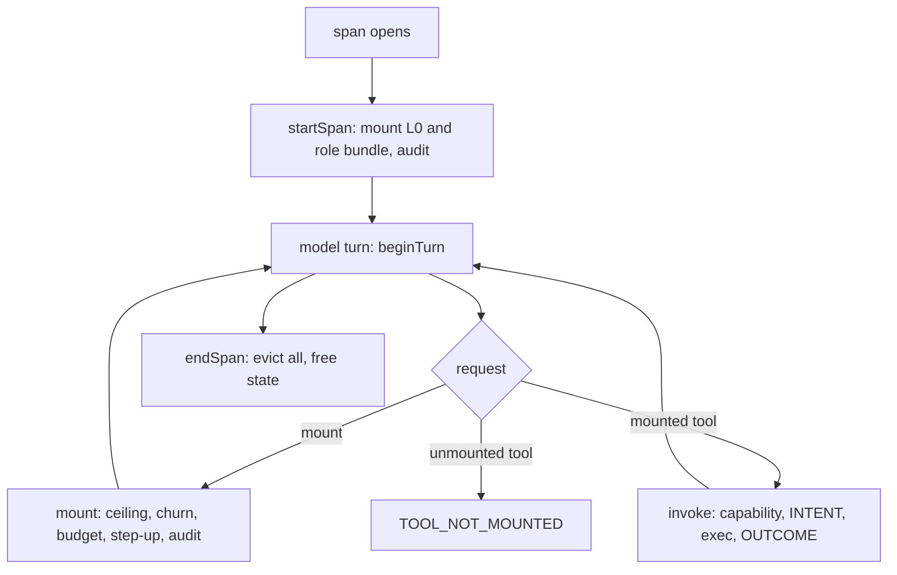

# Toolforge dynamic MCP tool scoping

| Field | Value |
| --- | --- |
| Status | **Approved by Tier 1 on 2026-10-15**, with D1–D3 deferred (section 12). |
| Date | 2026-10-15 |
| Supersedes | `toolforge-dynamic-mcp-scoping-spec.md` v1.0.0-PROD (marked "Approved for Implementation" without an approval record) |
| Normative base | [MCP 2026-07-28](https://modelcontextprotocol.io/specification/2026-07-28/basic/transports/streamable-http), as adopted in [stateless MCP migration](2026-10-10-stateless-mcp-migration.md) |
| Subsystems | `toolforge` (registry and execution gateway), `sigil` (capability grants), `rewrite-mcp`, `kb-sync` |
| Verified | Reference code in sections 5 and 6 type-checks under `tsc --strict` and passes 16 `node:test` cases (section 10). Zod 4.6.5, Node 24. |

## 1. Problem

A host that registers every MCP tool at bootstrap pays the schema cost on every turn and shows the model tools it does not need. Scoping tools to the active role and span cuts that cost and narrows the attack surface of a prompt-injected agent.

This spec is a hypothesis with a kill criterion, not a settled saving:

* **Illustrative baseline.** 20 detailed tool definitions at roughly 4,500 tokens (about 225 per tool). The figure is not sourced. Phase 2 replaces it with a measurement from the real `rewrite-mcp` and `toolforge` catalogs.
* **Illustrative target.** Cold-turn schema tokens fall from about 4,500 to about 700 (L0 at 250 plus one L1 bundle at 450), roughly 84% fewer uncached schema tokens.
* **Kill criterion.** The design is dropped if, on the Phase 2 replay corpus, cache-adjusted input cost per turn is not lower than both baselines in section 8: static registration and stable-superset with deferred schemas.

Scoping also has a security purpose that does not depend on the token saving: an agent can call only tools mounted for its span, and mounting mutating tools requires step-up approval.

## 2. Design decisions

1. **Scope state is keyed by span, not session.** A span is the unit of delegation. Parent and child spans share a `session_id` and must not share state.
2. **Every tool call passes `invoke`.** The hook is the enforcement point, not a bookkeeping layer. A tool that is not mounted in the calling span is rejected.
3. **Defaults fail closed.** `requires_step_up` has no default. A bundle that contains a `MUTATING` or `HIGH`-risk tool and omits step-up fails validation. The default step-up verifier denies everything.
4. **Authority only narrows down the span tree.** A child's bundle ceiling is the intersection of its role's permitted bundles and its parent's ceiling. A child's grants are the intersection of requested grants and the parent's grants. Step-up approvals are never inherited.
5. **Mounting is an audited privilege change.** Every mount, dismount, and expiry writes a `SCOPE_CHANGE` entry. A failed audit write rejects the mount.
6. **Mount at span start when possible.** Section 8 shows a mid-span mount invalidates the prompt cache. The role bundle mounts when the span opens, so the common path never pays that penalty.

### Open decisions (Tier 1)

| # | Decision | Why it blocks |
| --- | --- | --- |
| D1 | Where scope state lives. The reference code uses an in-process `Map`. | The stateless MCP migration ignores `Mcp-Session-Id` and lets any worker serve the next POST. A multi-worker deployment needs a shared store (for example the `sigil` Postgres) or a signed scope token carried in `_meta`. Phase 4 cannot ship on the in-memory store. |
| D2 | The production `StepUpVerifier`. | The reference code ships only a deny-all verifier and a test double. The binding is defined in section 7.3, but the Sigil approval record that satisfies it is not specified. |
| D3 | Whether `sigil-rooms-mcp` exists in time for Phase 3. | The package is planned in `sigil-repo` (tincan transport bridge spec, Milestone 1) and not built. |

## 3. Invariants and where they are enforced

| Invariant | Rule | Enforced by | Test |
| --- | --- | --- | --- |
| I1 Virtual paging | A span starts with L0 plus at most one non-step-up role bundle. Everything else mounts on demand and is evicted at span end or TTL. | `startSpan`, `mount`, `expire`, `endSpan` | L0 mounted at start; TTL evicts |
| I2 Side-effect tagging | Every tool declares `READ_ONLY` or `MUTATING`. A mutating call writes an `INTENT` entry before it runs and an `OUTCOME` entry after. | `ToolBundleContract`, `invoke` | WAL ordering; WAL failure blocks the call |
| I3 Span inheritance | Child ceiling and grants are subsets of the parent's. Contexts are keyed by `span_id`. | `startSpan` | Ceiling subset; grant intersection; no inherited step-up |
| I4 Step-up | A bundle with a `MUTATING` or `HIGH` tool mounts only after `StepUpVerifier` approves a claim bound to `{session_id, span_id, bundle_id}`. | `mount`, `ToolBundleContract` | Forged prefix token rejected; deny-all default |
| I5 Role gating | A role mounts only bundles whose `allowed_roles` include it. Discovery lists only the span's ceiling. | `mount`, `discover` | Role allowlist test |

## 4. Catalog

### 4.1 Canonical names

| Concept | Canonical name |
| --- | --- |
| L0 bundle | `bundle:toolforge_l0` |
| L0 tools | `toolforge_discover_bundles`, `toolforge_mount_bundle`, `toolforge_dismount_bundle` |
| Mount tool (v1.0 variants removed) | `toolforge_mount_bundle` (not `toolforge_mount_scope`) |
| Evict tool (v1.0 variants removed) | `toolforge_dismount_bundle` (not `toolforge_unmount_bundle`) |
| Domain bundles | `bundle:code_inspection`, `bundle:wiki_evidence`, `bundle:sigil_room`, `bundle:system_mutation` |

The v1.0 names `repo_reader`, `wiki_researcher`, `data_analyst`, and `sigil_room_member` are retired. Bundle IDs match `^bundle:[a-z0-9_]+$`.

### 4.2 Tiers and budgets

| Tier | Bundle | Schema budget | Step-up | Default roles |
| --- | --- | ---: | :---: | --- |
| L0 | `bundle:toolforge_l0` | 250 tokens | no | any |
| L1 | `bundle:code_inspection` | 800 tokens | no | `coder`, `reviewer` |
| L1 | `bundle:wiki_evidence` | 800 tokens | no | `researcher`, `reviewer` |
| L1 | `bundle:sigil_room` | 800 tokens | no | `reviewer`, `coder` |
| L2 | `bundle:system_mutation` | 1,500 tokens | **yes** | `coder` |

Role-to-bundle defaults are proposals for Tier 1 review. Default roles, the `roleBundles` start-up map (`coder` to `code_inspection`, `researcher` to `wiki_evidence`, `reviewer` to `sigil_room`), and budgets live in registry configuration, not in the hook.

### 4.3 Tool membership and confirmation status

| Bundle | Tools | Status |
| --- | --- | --- |
| `code_inspection` | `graft_find_code`, `graft_find_all`, `graft_trace_calls`, `graft_file_api`, `graft_repo_map` | Names match the `graft` MCP server exposed in this workspace. |
| `wiki_evidence` | `search_kb` | `search_kb` is present in `rewrite-mcp/scripts/rewrite-mcp-http-entry.mjs`. |
| `wiki_evidence` | `torque_resolve_span`, `fetch_fact_claim`, `query_fts5` | **Provisional.** No match in `kb-sync/src` or `rewrite-mcp`. Confirm or rename before Phase 2. |
| `sigil_room` | `sigil_post_message`, `sigil_request_review`, `sigil_attach_context`, `sigil_check_inbox` | **Provisional.** Depends on D3. |
| `system_mutation` | `write_file`, `execute_command`, `merge_pr`, `db_migrate` | Illustrative. Each needs a `required_capability` before registration. |

## 5. Contracts

`src/contracts/DynamicToolScope.ts`

```typescript
import { z } from 'zod';

export const SideEffect = z.enum(['READ_ONLY', 'MUTATING']);
export const RiskTier = z.enum(['LOW', 'STANDARD', 'HIGH']);

export const ToolDefinitionContract = z.object({
  name: z.string().min(1),
  description: z.string(),
  side_effect: SideEffect,
  risk_tier: RiskTier,
  required_capability: z.string().optional(),
  input_schema: z.record(z.string(), z.unknown()),
});

export const ToolBundleContract = z
  .object({
    bundle_id: z.string().regex(/^bundle:[a-z0-9_]+$/),
    domain: z.string(),
    description: z.string(),
    tools: z.array(ToolDefinitionContract).min(1),
    allowed_roles: z.array(z.string()).min(1), // '*' permits any role
    requires_step_up: z.boolean(), // no default: omission must fail validation
    max_mounted_ttl_ms: z.number().int().positive().nullable(), // null = until span end
  })
  .superRefine((bundle, ctx) => {
    const risky = bundle.tools.some((t) => t.side_effect === 'MUTATING' || t.risk_tier === 'HIGH');
    if (risky && !bundle.requires_step_up) {
      ctx.addIssue({
        code: 'custom',
        message: `${bundle.bundle_id}: a MUTATING or HIGH-risk tool requires requires_step_up=true`,
      });
    }
  });

export type ToolDefinition = z.infer<typeof ToolDefinitionContract>;
export type ToolBundle = z.infer<typeof ToolBundleContract>;

export type ScopeError =
  | 'INVALID_SPAN'
  | 'SPAN_HALTED'
  | 'BUNDLE_NOT_FOUND'
  | 'BUNDLE_NOT_PERMITTED'
  | 'STEP_UP_REQUIRED'
  | 'SCHEMA_BUDGET_EXCEEDED'
  | 'CIRCUIT_BREAKER_TOOL_CHURN'
  | 'TOOL_NOT_MOUNTED'
  | 'CAPABILITY_MISSING'
  | 'WAL_APPEND_FAILED';

export type Result<T> = ({ ok: true } & T) | { ok: false; error: ScopeError };

export interface StepUpClaim {
  session_id: string;
  span_id: string;
  bundle_id: string;
}

export interface WalEntry {
  phase: 'SCOPE_CHANGE' | 'INTENT' | 'OUTCOME';
  session_id: string;
  trace_id: string;
  span_id: string;
  tool?: string;
  bundle_id?: string;
  action?: 'MOUNT' | 'DISMOUNT' | 'EXPIRE';
  action_hash?: string;
  ok?: boolean;
}

/** Fail-closed ports. Production adapters live outside this file. */
export interface StepUpVerifier {
  verify(claim: StepUpClaim, evidence: string | undefined): Promise<boolean>;
}
export interface WriteAheadLog {
  append(entry: WalEntry): Promise<void>;
}
export interface TokenCounter {
  count(tool: ToolDefinition): number;
}
export interface Clock {
  now(): number;
}
/** Must be RFC 8785 JCS canonicalization of {tool, args} followed by SHA-256. */
export type ActionHasher = (tool: string, args: unknown) => string;
```

Notes:

* `requires_step_up` is required. `superRefine` rejects a bundle whose tools include `MUTATING` or `HIGH` without it.
* `max_mounted_ttl_ms` is a positive integer or `null`. `Infinity` is not used, because `z.number()` rejects it in Zod 4.
* `input_schema` replaces v1.0's `parameters` to match the MCP `inputSchema` field. Validate it as JSON Schema in the registry adapter.

## 6. Scoping hook

`src/hooks/DynamicToolScopingHook.ts`

```typescript
import { EventEmitter } from 'node:events';
import { ToolBundleContract } from '../contracts/DynamicToolScope.js';
import type {
  ActionHasher,
  Clock,
  Result,
  ScopeError,
  StepUpVerifier,
  TokenCounter,
  ToolBundle,
  ToolDefinition,
  WriteAheadLog,
} from '../contracts/DynamicToolScope.js';

export const L0_BUNDLE_ID = 'bundle:toolforge_l0';
export const SOFT_BUDGET_TOKENS = 1_800; // warn only
export const HARD_BUDGET_TOKENS = 2_600; // L0 250 + L1 800 + L2 1,500, plus margin: reject above
export const CHURN_MAX_OPS = 6;
export const CHURN_WINDOW_TURNS = 3;

export interface HookDeps {
  stepUp: StepUpVerifier;
  wal: WriteAheadLog;
  tokens: TokenCounter;
  clock: Clock;
  hashAction: ActionHasher;
  /** actor_role -> bundle mounted at span start. A bundle that requires step-up is never auto-mounted. */
  roleBundles: Record<string, string>;
}

export const heuristicTokenCounter: TokenCounter = {
  count: (tool) =>
    Math.ceil(
      JSON.stringify({ name: tool.name, description: tool.description, input_schema: tool.input_schema }).length / 3.8,
    ),
};

export const denyAllStepUp: StepUpVerifier = { verify: async () => false };

interface SpanScope {
  session_id: string;
  trace_id: string;
  span_id: string;
  parent_span_id?: string;
  actor_role: string;
  grants: Set<string>;
  ceiling: Set<string>; // bundles this span may ever mount: role-permitted and within the parent's ceiling
  mounted: Map<string, { at: number }>;
  turn: number;
  churn_turns: number[];
  halted: boolean;
  children: Set<string>;
  reclaimed_tokens: number;
}

const fail = (error: ScopeError) => ({ ok: false as const, error });
const roleAllowed = (b: ToolBundle, role: string) => b.allowed_roles.includes('*') || b.allowed_roles.includes(role);

export class DynamicToolScopingHook extends EventEmitter {
  private readonly deps: HookDeps;
  private readonly bundles = new Map<string, ToolBundle>();
  private readonly bundleTokens = new Map<string, number>();
  private readonly toolOwner = new Map<string, string>();
  private readonly spans = new Map<string, SpanScope>();
  private reclaimedTotal = 0;

  constructor(deps: HookDeps) {
    super();
    this.deps = deps;
    this.registerBundle({
      bundle_id: L0_BUNDLE_ID,
      domain: 'core',
      description: 'Discovery and dynamic tool mounting primitives',
      allowed_roles: ['*'],
      requires_step_up: false,
      max_mounted_ttl_ms: null,
      tools: [
        l0Tool('toolforge_discover_bundles', 'Search permitted tool bundles by intent keywords', 'query'),
        l0Tool('toolforge_mount_bundle', 'Mount a permitted tool bundle into this span', 'bundle_id'),
        l0Tool('toolforge_dismount_bundle', 'Evict a mounted tool bundle from this span', 'bundle_id'),
      ],
    });
  }

  /** Throws on an invalid bundle, a duplicate bundle id, or a tool name owned by another bundle. */
  registerBundle(raw: unknown): ToolBundle {
    const bundle = ToolBundleContract.parse(raw);
    if (this.bundles.has(bundle.bundle_id)) throw new Error(`DUPLICATE_BUNDLE ${bundle.bundle_id}`);
    for (const t of bundle.tools) {
      const owner = this.toolOwner.get(t.name);
      if (owner) throw new Error(`DUPLICATE_TOOL ${t.name} in ${owner} and ${bundle.bundle_id}`);
    }
    this.bundles.set(bundle.bundle_id, bundle);
    this.bundleTokens.set(
      bundle.bundle_id,
      bundle.tools.reduce((n, t) => n + this.deps.tokens.count(t), 0),
    );
    for (const t of bundle.tools) this.toolOwner.set(t.name, bundle.bundle_id);
    return bundle;
  }

  async startSpan(a: {
    session_id: string;
    trace_id: string;
    span_id: string;
    parent_span_id?: string;
    actor_role: string;
    grants: string[];
  }): Promise<Result<object>> {
    if (this.spans.has(a.span_id)) return fail('INVALID_SPAN');
    const parent = a.parent_span_id ? this.spans.get(a.parent_span_id) : undefined;
    if (a.parent_span_id && !parent) return fail('INVALID_SPAN');
    if (parent?.halted) return fail('SPAN_HALTED');

    const ceiling = new Set(
      [...this.bundles.values()]
        .filter((b) => roleAllowed(b, a.actor_role))
        .map((b) => b.bundle_id)
        .filter((id) => !parent || parent.ceiling.has(id)),
    );
    // Attenuation: a child never holds a grant its parent lacks. Step-up approvals are not inherited.
    const grants = new Set(parent ? a.grants.filter((g) => parent.grants.has(g)) : a.grants);
    const sc: SpanScope = {
      session_id: a.session_id,
      trace_id: a.trace_id,
      span_id: a.span_id,
      parent_span_id: a.parent_span_id,
      actor_role: a.actor_role,
      grants,
      ceiling,
      mounted: new Map(),
      turn: 0,
      churn_turns: [],
      halted: false,
      children: new Set(),
      reclaimed_tokens: 0,
    };
    this.spans.set(sc.span_id, sc);
    parent?.children.add(sc.span_id);
    this.mountUnchecked(sc, L0_BUNDLE_ID);

    const roleBundleId = this.deps.roleBundles[a.actor_role];
    const roleBundle = roleBundleId ? this.bundles.get(roleBundleId) : undefined;
    if (roleBundle && ceiling.has(roleBundle.bundle_id) && !roleBundle.requires_step_up) {
      if (!(await this.audit(sc, 'MOUNT', roleBundle.bundle_id))) {
        await this.endSpan(sc.span_id);
        return fail('WAL_APPEND_FAILED');
      }
      this.mountUnchecked(sc, roleBundle.bundle_id);
    }
    return { ok: true };
  }

  /** Host calls this once per model turn. Drives the churn window and TTL expiry. */
  beginTurn(spanId: string): void {
    const sc = this.spans.get(spanId);
    if (!sc) return;
    sc.turn += 1;
    this.expire(sc);
  }

  discover(
    spanId: string,
    query: string,
  ): Result<{ bundles: { bundle_id: string; description: string; requires_step_up: boolean; schema_tokens: number }[] }> {
    const sc = this.live(spanId);
    if (!sc) return fail('INVALID_SPAN');
    const words = query.toLowerCase().split(/\s+/).filter(Boolean);
    const bundles = [...sc.ceiling]
      .filter((id) => !sc.mounted.has(id))
      .map((id) => this.bundles.get(id)!)
      .filter((b) => {
        const hay = `${b.bundle_id} ${b.domain} ${b.description}`.toLowerCase();
        return words.length === 0 || words.some((w) => hay.includes(w));
      })
      .map((b) => ({
        bundle_id: b.bundle_id,
        description: b.description,
        requires_step_up: b.requires_step_up,
        schema_tokens: this.bundleTokens.get(b.bundle_id)!,
      }));
    return { ok: true, bundles };
  }

  async mount(spanId: string, bundleId: string, stepUpEvidence?: string): Promise<Result<{ mounted_tools: string[] }>> {
    const sc = this.live(spanId);
    if (!sc) return fail('INVALID_SPAN');
    if (sc.halted) return fail('SPAN_HALTED');
    const bundle = this.bundles.get(bundleId);
    if (!bundle) return fail('BUNDLE_NOT_FOUND');
    if (!sc.ceiling.has(bundleId)) return fail('BUNDLE_NOT_PERMITTED');
    if (sc.mounted.has(bundleId)) return { ok: true, mounted_tools: [] };
    if (this.recordChurn(sc)) return fail('CIRCUIT_BREAKER_TOOL_CHURN');
    if (this.spend(sc) + this.bundleTokens.get(bundleId)! > HARD_BUDGET_TOKENS) return fail('SCHEMA_BUDGET_EXCEEDED');

    if (bundle.requires_step_up) {
      const ok = await this.deps.stepUp.verify(
        { session_id: sc.session_id, span_id: sc.span_id, bundle_id: bundleId },
        stepUpEvidence,
      );
      // State may have changed while awaiting the verifier.
      if (!ok || this.spans.get(spanId) !== sc || sc.halted) return fail('STEP_UP_REQUIRED');
      if (sc.mounted.has(bundleId)) return { ok: true, mounted_tools: [] };
      if (this.spend(sc) + this.bundleTokens.get(bundleId)! > HARD_BUDGET_TOKENS) return fail('SCHEMA_BUDGET_EXCEEDED');
    }
    if (!(await this.audit(sc, 'MOUNT', bundleId))) return fail('WAL_APPEND_FAILED');
    if (this.spans.get(spanId) !== sc) return fail('INVALID_SPAN');

    this.mountUnchecked(sc, bundleId);
    if (this.spend(sc) > SOFT_BUDGET_TOKENS) {
      this.emit('SCHEMA_SATURATION_WARNING', { span_id: sc.span_id, schema_tokens: this.spend(sc) });
    }
    return { ok: true, mounted_tools: bundle.tools.map((t) => t.name) };
  }

  async dismount(spanId: string, bundleId: string): Promise<Result<{ reclaimed_tokens: number }>> {
    const sc = this.live(spanId);
    if (!sc) return fail('INVALID_SPAN');
    if (sc.halted) return fail('SPAN_HALTED');
    if (bundleId === L0_BUNDLE_ID) return fail('BUNDLE_NOT_PERMITTED');
    if (!sc.mounted.has(bundleId)) return fail('BUNDLE_NOT_FOUND');
    if (this.recordChurn(sc)) return fail('CIRCUIT_BREAKER_TOOL_CHURN');
    if (!(await this.audit(sc, 'DISMOUNT', bundleId))) return fail('WAL_APPEND_FAILED');
    return { ok: true, reclaimed_tokens: this.dismountUnchecked(sc, bundleId) };
  }

  /** The only path by which a tool may run. Tools outside the span's mounted bundles are rejected. */
  async invoke<T>(
    spanId: string,
    toolName: string,
    args: unknown,
    exec: (args: unknown) => Promise<T>,
  ): Promise<Result<{ value: T }>> {
    const sc = this.live(spanId);
    if (!sc) return fail('INVALID_SPAN');
    if (sc.halted) return fail('SPAN_HALTED');
    const hit = this.findMounted(sc, toolName);
    if (!hit) return fail('TOOL_NOT_MOUNTED');
    const { tool } = hit;
    if (tool.required_capability && !sc.grants.has(tool.required_capability)) return fail('CAPABILITY_MISSING');

    const mutating = tool.side_effect === 'MUTATING';
    const action_hash = mutating ? this.deps.hashAction(toolName, args) : undefined;
    const base = { session_id: sc.session_id, trace_id: sc.trace_id, span_id: sc.span_id, tool: toolName, action_hash };
    if (mutating) {
      try {
        await this.deps.wal.append({ ...base, phase: 'INTENT' }); // write-ahead: intent is durable before the effect
      } catch {
        return fail('WAL_APPEND_FAILED');
      }
    }
    let value: T;
    try {
      value = await exec(args);
    } catch (err) {
      if (mutating) await this.deps.wal.append({ ...base, phase: 'OUTCOME', ok: false }).catch(() => undefined);
      throw err;
    }
    if (mutating) await this.deps.wal.append({ ...base, phase: 'OUTCOME', ok: true }).catch(() => this.emit('walOutcomeLost', base));
    sc.churn_turns = []; // a functional call resets the churn window
    return { ok: true, value };
  }

  getActiveTools(spanId: string): ToolDefinition[] {
    const sc = this.live(spanId);
    if (!sc) return [];
    return [...sc.mounted.keys()].flatMap((id) => this.bundles.get(id)!.tools);
  }

  snapshot(spanId: string) {
    const sc = this.live(spanId);
    if (!sc) return undefined;
    return {
      active_bundles: [...sc.mounted.keys()],
      mounted_tools_count: this.getActiveTools(spanId).length,
      schema_tokens: this.spend(sc),
      reclaimed_tokens_span: sc.reclaimed_tokens,
      reclaimed_tokens_total: this.reclaimedTotal,
      halted: sc.halted,
    };
  }

  /** Ends the span and its descendants, evicting every mounted bundle. */
  async endSpan(spanId: string): Promise<void> {
    const sc = this.spans.get(spanId);
    if (!sc) return;
    for (const child of [...sc.children]) await this.endSpan(child);
    for (const id of [...sc.mounted.keys()]) this.dismountUnchecked(sc, id);
    this.spans.delete(spanId);
    if (sc.parent_span_id) this.spans.get(sc.parent_span_id)?.children.delete(spanId);
  }

  private live(spanId: string): SpanScope | undefined {
    const sc = this.spans.get(spanId);
    if (sc) this.expire(sc);
    return sc;
  }

  private spend(sc: SpanScope): number {
    let n = 0;
    for (const id of sc.mounted.keys()) n += this.bundleTokens.get(id)!;
    return n;
  }

  private findMounted(sc: SpanScope, toolName: string): { tool: ToolDefinition; bundle: ToolBundle } | undefined {
    const owner = this.toolOwner.get(toolName);
    if (!owner || !sc.mounted.has(owner)) return undefined;
    const bundle = this.bundles.get(owner)!;
    return { tool: bundle.tools.find((t) => t.name === toolName)!, bundle };
  }

  private mountUnchecked(sc: SpanScope, bundleId: string): void {
    sc.mounted.set(bundleId, { at: this.deps.clock.now() });
    this.emit('toolsChanged', { span_id: sc.span_id, trace_id: sc.trace_id, action: 'MOUNT', bundle_id: bundleId });
  }

  private dismountUnchecked(sc: SpanScope, bundleId: string): number {
    const reclaimed = this.bundleTokens.get(bundleId)!;
    sc.mounted.delete(bundleId);
    sc.reclaimed_tokens += reclaimed;
    this.reclaimedTotal += reclaimed;
    this.emit('toolsChanged', { span_id: sc.span_id, trace_id: sc.trace_id, action: 'DISMOUNT', bundle_id: bundleId });
    return reclaimed;
  }

  /** TTL expiry only removes authority, so a failed audit append does not block it. */
  private expire(sc: SpanScope): void {
    const now = this.deps.clock.now();
    for (const [id, m] of sc.mounted) {
      const ttl = this.bundles.get(id)!.max_mounted_ttl_ms;
      if (ttl !== null && now - m.at > ttl) {
        this.dismountUnchecked(sc, id);
        void this.audit(sc, 'EXPIRE', id);
      }
    }
  }

  /** Counts a mount or dismount. Returns true and halts the span when the churn limit trips. */
  private recordChurn(sc: SpanScope): boolean {
    sc.churn_turns.push(sc.turn);
    sc.churn_turns = sc.churn_turns.filter((t) => t > sc.turn - CHURN_WINDOW_TURNS);
    if (sc.churn_turns.length > CHURN_MAX_OPS) {
      sc.halted = true;
      this.emit('CIRCUIT_BREAKER_TOOL_CHURN', { span_id: sc.span_id });
      return true;
    }
    return false;
  }

  private async audit(sc: SpanScope, action: 'MOUNT' | 'DISMOUNT' | 'EXPIRE', bundle_id: string): Promise<boolean> {
    try {
      await this.deps.wal.append({
        phase: 'SCOPE_CHANGE',
        session_id: sc.session_id,
        trace_id: sc.trace_id,
        span_id: sc.span_id,
        bundle_id,
        action,
      });
      return true;
    } catch {
      return false;
    }
  }
}

function l0Tool(name: string, description: string, param: string): ToolDefinition {
  return {
    name,
    description,
    side_effect: 'READ_ONLY',
    risk_tier: 'LOW',
    input_schema: { type: 'object', properties: { [param]: { type: 'string' } }, required: [param] },
  };
}
```

Notes:

* The MCP server maps the three L0 tool calls to `discover`, `mount`, and `dismount`. All other tool calls go through `invoke`.
* `toolsChanged` is an in-process event. The MCP layer forwards it to clients that opened `subscriptions/listen` with `toolsListChanged` (section 7.2).
* `expire` removes authority without waiting for the audit write, because removing a bundle cannot widen access.
* The default `heuristicTokenCounter` is a stand-in. Phase 2 replaces it with counts measured against the target model.

## 7. Request flow

### 7.1 Lifecycle

```
span opens ──► startSpan: mount L0 (+ role bundle if no step-up), audit
   │
   ▼
model turn ──► beginTurn: advance churn window, expire TTL bundles
   │
   ├─ calls L0 mount ──► mount: ceiling ─► churn ─► budget ─► step-up ─► audit ─► mount
   ├─ calls a mounted tool ──► invoke: mounted? ─► capability ─► [INTENT] ─► exec ─► [OUTCOME]
   └─ calls an unmounted tool ──► TOOL_NOT_MOUNTED
   │
   ▼
span closes ──► endSpan: close children, evict all bundles, free state
```

<details><summary>Mermaid source for the lifecycle diagram</summary>



</details>

The architecture diagram still needs the standalone HTML+SVG and PNG artifacts required by the project diagram standard (see section 12).

### 7.2 Stateless MCP binding

The stateless migration ignores `Mcp-Session-Id` and moves tool-list change notifications to `subscriptions/listen`. The binding is:

1. The client sends `toolforge/span_id` in request `_meta`. A request without it is scoped to a fresh root span with the L0 bundle only.
2. `tools/list` returns `getActiveTools(span_id)`. The list is computed per request from the scope store, never from connection state.
3. A mount or dismount takes effect on the next `tools/list`. The hook emits `toolsChanged`, and the server delivers `toolsListChanged` to clients listening via `subscriptions/listen`. A host that does not subscribe sees the change only when it re-lists.
4. Decision D1 settles where the scope store lives. Every worker must read the same store.

### 7.3 Step-up claim

The verifier receives `{session_id, span_id, bundle_id}` and an opaque `evidence` string. An implementation must:

* verify a signature or server-side record issued by Sigil for the capability `sigil.approval/request` (registered at `risk_tier: high`);
* bind the approval to the three claim fields, an expiry, and a single use;
* when the approval covers an action rather than a bundle, compare the RFC 8785 JCS hash of `{tool, args}` with `action_hash` in the `INTENT` entry.

A string prefix is never evidence. The test `forged prefix token` guards that.

## 8. Cost model

Tools sit first in the cacheable prefix (tools, then system, then messages). Any change to the tool list invalidates the cache from that point on. Define:

* `T_static`: tokens in the static tool block (illustrative 4,500).
* `T_scoped`: tokens in the scoped tool block (illustrative 700).
* `H`: tokens after the tool block (system plus history) at the moment of the mount.
* `r`, `w`: cache-read and cache-write price multipliers relative to base input price.

Each mount or dismount costs one cache miss on the next turn: `(w − r) · (T_scoped + H)`. Each later turn saves `r · (T_static − T_scoped)` versus the static baseline. A mount breaks even after

```
N* = (w − r) · (T_scoped + H) / ( r · (T_static − T_scoped) )   turns
```

Worked example, assuming `r = 0.1` and `w = 1.25` (5-minute cache write). **Verify both against current pricing before relying on this table.**

| History `H` at mount | Break-even `N*` |
| ---: | ---: |
| 0 (span start) | 2.1 turns |
| 5,000 | 17.3 turns |
| 20,000 | 62.6 turns |

Consequences:

* A span-start mount pays for itself in about two turns. A mid-span mount into a long history rarely does. The hook therefore auto-mounts the role bundle at `startSpan`, and model-driven mounts are reserved for bundles the role did not need at the start (step-up bundles in particular).
* Every mount and dismount pair is two invalidations. The churn breaker limits the damage, and telemetry records `H` at each mount (`toolforge.scope.mount_history_tokens`) so Phase 4 reports realized penalty rather than the estimate.
* Phase 2 builds a replay harness over recorded `rewrite-mcp` and `toolforge` sessions and compares three arms: **A** static registration, **B** stable-superset with deferred schema loading (tool search, cache stays intact), **C** this design. Section 1's kill criterion applies to that result.

## 9. Budgets and circuit breakers

| Control | Value | Behavior |
| --- | --- | --- |
| Soft budget | 1,800 tokens per span | Emits `SCHEMA_SATURATION_WARNING`. Does not block. |
| Hard budget | 2,600 tokens per span | `mount` returns `SCHEMA_BUDGET_EXCEEDED`. Equals L0 250 + L1 800 + L2 1,500 plus margin, so a step-up bundle and an L1 bundle can coexist. |
| Churn breaker | More than 6 mount or dismount operations within the last 3 turns, with no functional tool call between | Halts the span: the 7th operation returns `CIRCUIT_BREAKER_TOOL_CHURN`, and later calls return `SPAN_HALTED`. A successful `invoke` resets the window. |

"Turn" means a `beginTurn` call from the host. "Functional tool call" means any successful `invoke`.

## 10. Verification

Run with `timeout 60 node --test test/scoping-hook.test.ts`. 16 of 16 passed on 2026-10-15 against the reference code above.

| Review finding | Test |
| --- | --- |
| 1 Forged step-up token | `step-up fails closed on a forged prefix token and with the default deny verifier` |
| 2 L0 never mounted | `L0 discovery tools are mounted at span start, with or without a role bundle` |
| 3 No call-time enforcement | `invoke rejects unmounted tools…`; `failed WAL append blocks a mutating call…`; `required_capability is enforced; TTL evicts a bundle` |
| 4 Step-up default and registration | `registration rejects a MUTATING tool in a bundle without step-up, and a missing flag` |
| 5 Role gating and discovery leak | `role allowlist blocks mounting and hides bundles from discovery` |
| 6 Span inheritance | `child span ceiling is a subset…`; `a child grants are the intersection…`; `step-up approval on a parent is not inherited…`; `endSpan cascades…` |
| Shared tool names | `duplicate tool names across bundles are rejected` |
| Ceiling and breaker | `hard budget rejects…`; `churn breaker…`; `a functional tool call resets the churn window` |
| Telemetry | `reclaimed tokens accumulate on dismount and span end` |

### Telemetry

| Attribute | Source |
| --- | --- |
| `gen_ai.tool_schema.tokens` | `snapshot().schema_tokens` (replace the heuristic with measured counts) |
| `toolforge.scope.active_bundles` | `snapshot().active_bundles` |
| `toolforge.scope.mounted_tools_count` | `snapshot().mounted_tools_count` |
| `toolforge.scope.reclaimed_tokens_total` | `snapshot().reclaimed_tokens_total` |
| `toolforge.scope.mount_history_tokens` | Host-supplied `H` at each mount (not yet emitted by the hook) |

## 11. Phases

| Phase | Deliverable | Gate |
| :---: | --- | --- |
| 1 | Contracts and hook (sections 5 and 6) in `toolforge` at `modules/mcp-scoping/` (`.mjs`, branch `feat/mcp-scoping`, commit `6ab43057`) | The 16 tests pass under `timeout 60` (`npm run test:mcp-scoping`). Decisions D1 and D2 recorded in section 12. **Done 2026-10-15; not yet merged.** |
| 2 | Partition `rewrite-mcp` and `toolforge` catalogs into the four domain bundles. Build the replay harness. | Measured tokens per bundle within section 4.2 budgets. Section 1 kill criterion evaluated on arms A, B, and C. |
| 3 | `sigil-rooms-mcp` auto-mount on room join | Depends on D3. Multi-agent room integration test. |
| 4 | Production rollout with OpenTelemetry | Cache-adjusted input cost per turn lower than arms A and B on the replay corpus. The numeric threshold is set from Phase 2 data. A shared scope store (D1) is in place. |

## 12. External references and sign-off

### Reference check (2026-10-15)

| Reference | Result |
| --- | --- |
| MCP revision 2026-07-28 | Confirmed. Cited as the normative base in the stateless MCP migration spec. |
| SEP-2596 | **Removed as a basis.** The stateless migration spec describes it as the spec feature lifecycle and deprecation policy. It does not define tool scoping. |
| `sigil.task/process`, `sigil.approval/request` | Confirmed in `sigil-repo` docs and plans. `sigil.approval/request` is registered at `risk_tier: high`. |
| `sigil-rooms-mcp` | Planned in the `sigil-repo` tincan transport bridge spec and plan. Not built. |
| `search_kb` | Confirmed in `rewrite-mcp`. |
| `torque_resolve_span`, `fetch_fact_claim`, `query_fts5` | Not found in `kb-sync/src` or `rewrite-mcp`. Provisional. |
| "Toolforge Runtime v2.85+" | Removed. No source found. |
| "Production trace engineering analysis" (4,500 tokens, 200k to 70k usable) | Unsourced. The 4,500 figure is kept as illustrative. The 70k claim is removed. |

### Standards still open

* Architecture diagrams must follow the project `diagram-design` standard (standalone HTML+SVG, PNG, Mermaid source in `<details>`). Section 7.1 has the Mermaid source and an ASCII sketch only.

### Tier 1 sign-off

| Field | Value |
| --- | --- |
| Reviewed by | Chris Sorensen (sorensencc) |
| Decision (approve, amend, reject) | Approved, with D1–D3 deferred |
| Decisions D1–D3 resolved | No. Deferred with the conditions below. |
| Date | 2026-10-15 |
| Signature | Typed approval in the 2026-10-15 session transcript. No separate signature artifact exists. |

Conditions of approval:

* **D1, shared scope store.** Deferred to Phase 4. Phases 1 to 3 use the in-memory loopback store. The Phase 4 gate stays blocked until a shared store is in place.
* **D2, production step-up verifier (WebAuthn or OIDC).** Deferred to Phase 3. Phases 1 and 2 use the deny-all verifier and the test double only.
* **D3, `sigil-rooms-mcp` timing.** Deferred to Phase 3.

Each deferred decision must be resolved and recorded in the phase it was deferred to.

## 13. Changes from v1.0.0

* Rewrote the hook around spans, `invoke`, WAL, TTL, budgets, churn, and fail-closed defaults (review blockers 1–6).
* Replaced the prefix-cache argument with the cost model in section 8 and a kill criterion.
* Reconciled tool names, bundle names, and token figures (single 4,500 to 700 illustration; ceiling now consistent with the tier budgets).
* Added the stateless MCP binding and open decision D1.
* Removed unverifiable references and recorded the check in section 12.
* Marked the status Draft and moved the file under `docs/meta/specs/`.
