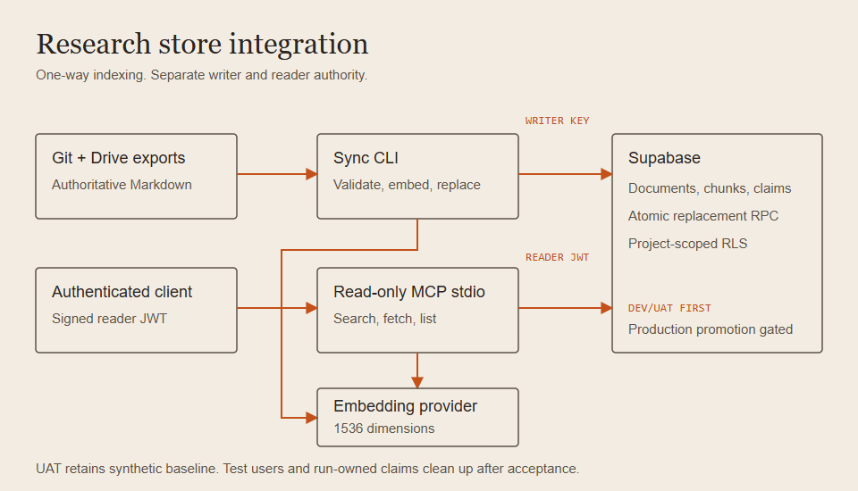
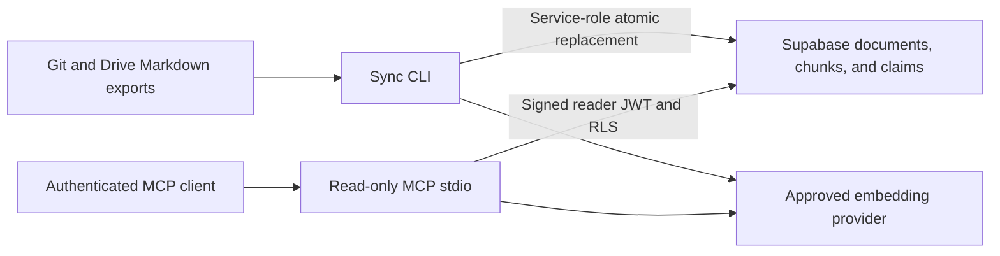

# Research store integration

Git and exported Drive Markdown remain authoritative. Sync alone receives writer credentials. MCP uses authenticated readers under Supabase RLS; staging and production use separate projects and credentials.

Mermaid source

Rendered source: [Standalone integration diagram](docs/integration.html). Dev/UAT API acceptance uses deterministic loopback embeddings; real provider quality remains a rollout gate.
