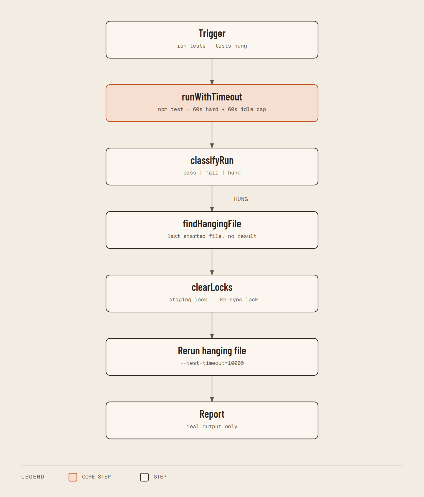

# Run Tests Safe — Integration Diagram

**Status: IMPLEMENTED**



<details><summary>Text flow source</summary>

```
User / agent ("run tests", "tests hung")
        |
        v
run-tests-safe (node, src/index.mjs)
        |
        +---> runWithTimeout: spawns npm test / node --test, 60s hard + 60s idle cap
        |         |
        |         +---> killTree (taskkill /T /F or process group) on timeout
        |
        +---> classifyRun -> pass | fail | hung
        |
        +---> hung: findHangingFile, clearLocks (.staging.lock, .kb-sync.lock),
        |           rerun the file with --test-timeout=10000
        v
real test output + hanging file name
```

</details>
