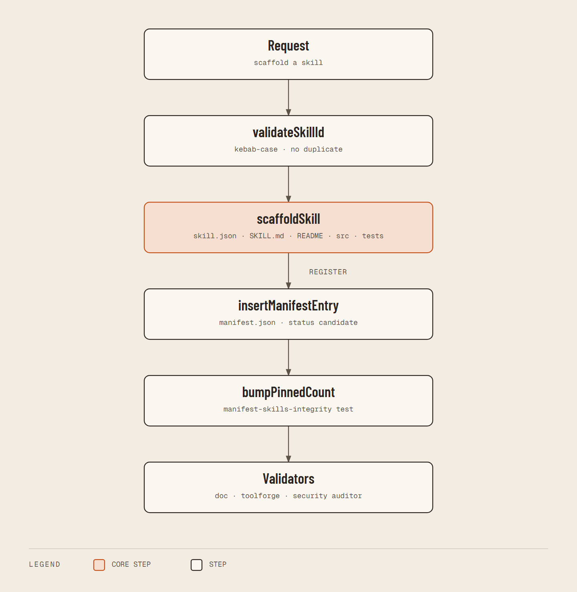

# Scaffold Toolforge Skill — Integration Diagram

**Status: IMPLEMENTED**



<details><summary>Text flow source</summary>

```
User ("scaffold a skill")
        |
        v
scaffold-toolforge-skill (node, src/index.mjs)
        |
        +---> validateSkillId -> scaffoldSkill (skills/<id>/ from template layout)
        |
        +---> insertManifestEntry -> manifest.json (candidate)
        |
        +---> bumpPinnedCount -> tests/manifest-skills-integrity.test.mjs
        |
        v
validators: skill-doc-validator.ps1, toolforgeSkillValidator.ps1,
            skill-security-auditor.py
```

</details>
