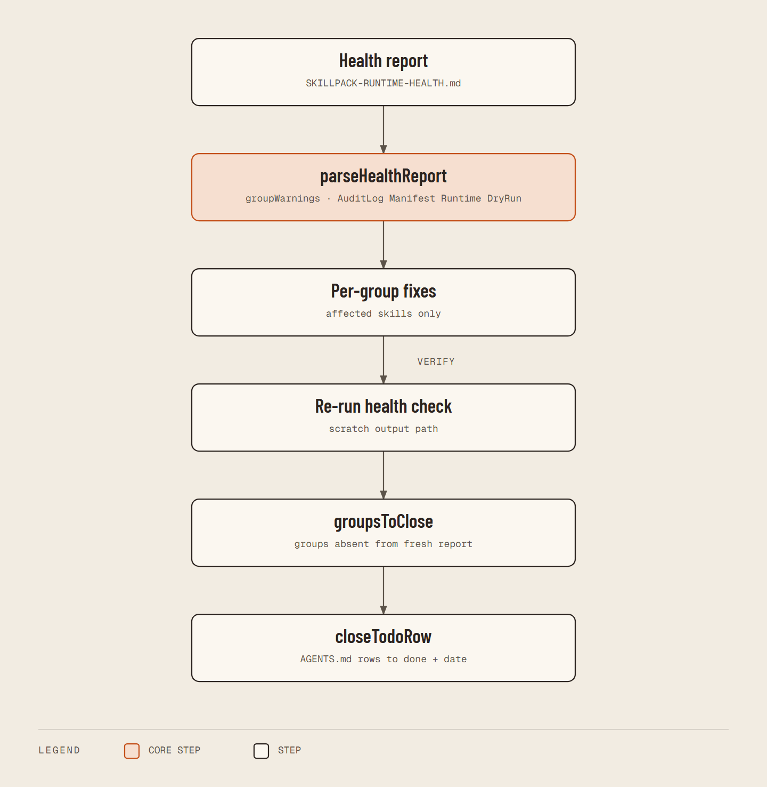

# Triage Skill Health Warnings — Integration Diagram

**Status: IMPLEMENTED**



<details><summary>Text flow source</summary>

```
utilities/toolforgeSkillHealthCheck.ps1
        |
        | writes skills/SKILLPACK-RUNTIME-HEALTH.md
        v
triage-skill-health-warnings (node, src/index.mjs)
        |
        +---> parseHealthReport -> groupWarnings (AuditLog, Manifest, Runtime, DryRun)
        |
        +---> per-group fixes in the affected skills only
        |
        +---> re-run health check to a scratch path -> groupsToClose
        |
        v
closeTodoRow edits root AGENTS.md (todo-group rows -> done + resolved date)
```

</details>
